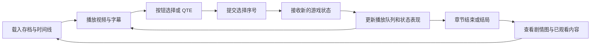
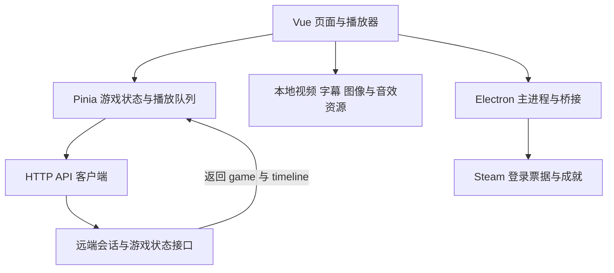

# 江山北望 游戏设计架构与技术栈

记录日期：2026-11-12。适用本机发布包 `project-beifa-client-full` 1.1.16，资源与此前 build 21189939 的恢复证据一致。本文件依据已发布客户端代码、字幕、剧情图和包清单整理，属于恢复后的设计文档，不是找回的原始策划案。

文中的“已确认”表示静态资源或代码中有直接证据；“设计解读”表示对这些结构的归纳；“未知”表示当前资料不足。未启动游戏、未调用游戏服务器，不能据此证明当前在线服务可用或所有路线都能实机走通。

## 1. 游戏定位与叙事核心

从字幕、视频节点和播放器实现看，本作以分支影视叙事为主体：玩家扮演宣国晋王司空耀，在皇室、门阀、军队和亲密关系之间作出选择。背景是北方失陷后的南方政权，人物逐步经历朝廷政治、北伐战争、夺位、治理与继承问题。[剧情概要依据](../../research/jiangshan-beiwang/剧情概要与关键对白.md)

**设计解读：** 故事将“恢复山河”的宏观目标与具体人物的生存、忠诚和牺牲联系起来。玩家的主要行动是选择立场与处置方式，战斗情境则通过视频和 QTE 等交互表现。现有证据支持将其理解为“观看—决策—结果—回看”的叙事游戏，而不是从角色移动或战斗数值系统出发的游戏。

### 章节承担的叙事功能

以下为已有情境整理的归纳，不将互斥支线合并为唯一故事。

| 章节 | 叙事阶段 | 核心冲突与设计作用 |
|---|---|---|
| 序章 大风起 | 初入政治 | 虞宫风波、父皇猜疑与兄长竞争；建立关系和权力判断 |
| 第一章 雨打萍 | 生存与失去 | 联姻、圈套与审讯；让政治选择的代价落到身边人身上 |
| 第二章 蛟入海 | 寻找力量 | 争取军方支持、讨论北伐；从京城转向军中 |
| 第三章 试锋刀 | 战场责任 | 守城、流民、义军与敌军计谋；考验理想与决断 |
| 第四章 破山缺 | 战争极限 | 围城与救援；失败路线密集，强调判断与生存 |
| 第五章 问天命 | 权力转折 | 兵权危机与南下夺位；政治目标和亲密关系冲突 |
| 第六章 太平志 | 执政与秩序 | 从争取权力转向如何运用权力，面对治理与利益关系 |
| 第七章 九州同 | 长期结果 | 收束个人、家国与继承选择，呈现不同终局 |

## 2. 玩家体验循环

**已确认的客户端行为：** 时间线里的 `play_video` 被转换为视频播放项；普通按钮来自 `timeline.actions` 中的 `ui_button`；选项提交后重新读取返回的游戏状态。部分场景进入循环视频等待选择；存在 `time_limit_choose`，有时间限制的选择不能全部当作无限等待。[游戏状态代码](../restored-complete/code-readable/.vite/renderer/main_window/assets/game-BTLGP1Kl.js)

### 交互与反馈

| 系统 | 已确认内容 | 尚未恢复的部分 |
|---|---|---|
| 普通选择 | 按钮有 prompt、index、key；选择提交给 API | 全量按钮原文与出口规则 |
| 限时选择 | 客户端识别 `time_limit_choose` | 每个节点的实际时限、默认项与后果 |
| QTE | 存在 `qte_slide`、`qte_trigger`、`qte_continue` 的分发处理 | 每段 QTE 的完整配置与成功失败条件 |
| 概率回调 | `possibility_trigger` 使用 0.2 概率参数选择 success / failure | 对应哪些剧情、是否还有服务端条件 |
| 计数回调 | `count_trigger` 增加局部计数，达到 3 后提交 enough | 对应场景、设计含义与完整生命周期 |
| 关系与数值反馈 | `value_changed` 累加时间线增量；播放器另有关系升降提示 | 全部变量、初值、阈值、跨章继承规则 |
| 完成度 | 按已访问故事单元与视频映射计算部分章节完成信息 | 与所有隐藏条件的对应关系 |
| 成就与结局 | 本地映射表、结局界面及 Steam 成就调用 | 成就是否均可达，以及所有触发条件 |

概率与计数是代码中的回调，不应直接命名为某个具体结局的概率或“全存档累计三次”。关系提示也不等于真实数值变化量。

## 3. 剧情数据模型

本作至少有三个需要区分的层次：故事单元 `storylet`、具体视频 `video`、推进时返回的 `timeline`。一个故事单元可以映射多个视频；视频图节点不能直接等同于一个选择点。[视频映射](../restored-complete/code-readable/.vite/renderer/main_window/assets/videos-CYDeOwst.js)

| 对象或字段 | 已知作用 |
|---|---|
| `storylet` / `storylet_start` / `storylet_end` | 标识时间线中的故事单元边界 |
| `videoId` / `play_video` | 指定播放素材；与字幕文件和图节点关联 |
| `timeline.lines` | 顺序事件记录，包含播放、状态变化和故事单元边界 |
| `timeline.actions` | 当前可提交的动作，包含普通按钮或特殊交互 |
| `visited_storylets` | 已访问故事单元；参与观看状态与完成度计算 |
| `selected_actions` | 已选择动作记录 |
| `value_changed` | 带有变量名和增量的数值事件 |
| `assigns_state` / `assigns_badge` | 客户端识别的事件类型；完整服务端语义未知 |
| SVG 路径 ID | 剧情显示图的两个连线端点；不含完整规则式 |
| VTT | 对应视频的时间码与字幕文本，通常不标说话人 |

### 分支、合流与结局

当前显示图恢复出 **615 个节点、770 条唯一连线、59 个结局**。其中保留 10 条跨章连线；没有证据的章际连接不补造。两份字幕没有匹配到显示图，两个图节点没有对应中文字幕。逐章剧本收录这两类缺口。

显示图是“故事可能怎样连接”的证据；时间线是“某份游戏状态实际如何推进”的数据。两者不能互相替代。图上分岔可能对应选项、隐藏条件或特殊交互，不能只根据出度判断。合流也只表示多条来路汇入同一节点，不表示之前的状态被清空。

59 个结局的既有索引计算出 142,138 条按各章入口到结局的图上组合路径。这个数不是已验证的可玩路线数：隐藏状态可能排除部分组合，且前章选择可能影响后章结果。[结构数据](../restored-complete/data/route-graph.json)

**设计解读：** 分支后复用共同视频，可以在有限素材量下表达多条人生路线；用状态变量延迟兑现早期选择，则能让合流后的相同画面继续承接不同人物关系。后一点与客户端的状态结构相符，但具体哪条线采用何种条件仍待规则证据。

## 4. 功能架构

界面资源包含主菜单、章节选择、播放器、剧情图、人物资料、成就、设置、公告、制作人员、许可信息以及休闲播放页面。这里确认的是模块存在，不是每个功能都经过实机测试。[页面与路由入口](../restored-complete/code-readable/.vite/renderer/main_window/assets/router-BE9Fjxsm.js)

| 层次 | 主要职责 | 关键材料 |
|---|---|---|
| 内容层 | 视频、字幕、章节、人物文本、结局文本、剧情图 | 章节 pack、语言模块、SVG |
| 表现层 | 页面导航、视频播放、字幕、选择按钮、QTE、提示动画 | Vue 页面及 StoryletPlayer |
| 游戏状态层 | 当前存档、播放队列、观看记录、动作提交、完成度 | game 模块、Pinia |
| 服务访问层 | 会话、存档载入、选择、跳转、复制、故事单元查询 | navigation 模块中的 API 客户端 |
| 桌面与平台层 | Electron 窗口、IPC、Steam 登录票据及成就 | main.js、preload.js、Steamworks |
| 构建与质量工具 | 前端打包、桌面制作、类型检查与测试命令 | package.json |

服务端框中的职责只依据客户端可见接口归纳；服务端语言、数据库、部署方式和内部规则引擎均未知。现有资料不能支持“所有内容离线即可正常推进”的判断。

## 5. 客户端与服务端的边界

客户端的存档 API 定义如下：[navigation 代码](../restored-complete/code-readable/.vite/renderer/main_window/assets/navigation-D0fhxgIL.js)

| 请求 | 客户端用途 |
|---|---|
| `GET api/games` | 获取游戏存档列表 |
| `POST api/games` | 创建游戏状态 |
| `GET api/games/{id}` | 读取单份状态 |
| `POST api/games/{id}/act/{index}` | 提交选择序号，读取返回的 `.game` |
| `POST api/games/{id}/jump/{target}` | 请求跳转 |
| `POST api/games/{id}/copy` | 请求复制 |
| `GET api/games/{id}/storylets` | 查询故事单元列表 |

这些接口名和调用代码不证明服务现在可用，也不能证明接口返回了完整隐藏条件。本次没有实际请求这些接口。

**遗产保护的关键缺口：** 本地素材和客户端程序能够恢复相当多的阅读内容，但缺少服务器状态推进逻辑时，不能仅凭 SVG 拼出原游戏的准确规则。若将来制作离线可玩恢复版，应把“证据支持的规则”和“人工重建的规则”分别记录，避免把后者标成原作机制。

## 6. 技术栈与版本依据

下表版本均来自发布包 [package.json](../restored-complete/code-original/package.json)。带 `^`、`~` 的值是声明范围，不是对实际安装精确版本的断言；开发依赖声明也不等于源工程和测试文件已恢复。

| 类别 | 依赖与声明版本 | 用途或证据范围 |
|---|---|---|
| 桌面容器 | Electron `37.10.3` | 主进程创建桌面窗口，发布入口为 `.vite/build/main.js` |
| UI | Vue `^3.5.25` | 页面与组件体系 |
| 状态 | Pinia `^3.0.4`；persistedstate `^4.7.1` | 状态管理及持久化依赖；不能据此认定完整存档离线保存 |
| 路由 | vue-router `^4.6.3` | 主菜单、播放器等页面导航 |
| 多语言 | vue-i18n `^11.2.2` | 本地中文、英、日、韩、俄语言模块 |
| HTTP | ky `^1.14.0` | 会话与游戏接口访问 |
| Steam | `@dsh0416/steamworks.js` `0.4.0` | 主进程存在票据及成就相关调用 |
| 动画与界面组件 | animejs `^4.2.2`；swiper `^12.0.3`；VueUse `^13.9.0` | 包清单声明；逐项使用范围未完整审计 |
| 媒体相关 | videojs-vr `^2.0.0`；浏览器音频 API | 包内存在播放器依赖；media 模块直接使用 AudioBuffer 等机制。依赖名不能证明 VR 是实际玩法 |
| 文本处理 | marked `^16.4.2`；isomorphic-dompurify `^2.33.0` | Markdown 与 HTML 清理相关依赖 |
| 监控与分析 | Sentry Electron `~7.1.1`、Vue `~10.11.0`；Mixpanel `^2.72.0` | 清单与打包标记可见；未验证实际上传行为 |
| 前端构建 | `vite: npm:rolldown-vite@^7.2.10` | Vite 命令使用 rolldown-vite 别名包 |
| 桌面构建 | Electron Forge `^7.10.2` | start / package / make / publish 脚本 |
| 语言与类型 | TypeScript `^5.9.3`；vue-tsc `^3.1.5` | 原开发流程含类型检查；已恢复的是发布 JavaScript |
| 开发运行约束 | Node `^22.21.1` | engines 声明；不是 Electron 内嵌 Node 版本 |
| 包管理 | `packageManager: pnpm@10.18.2`；另有 pnpm 依赖 `^10.24.0` | 两处声明不同，原锁文件与实际构建环境未恢复 |
| 测试与规范 | Vitest `^3.2.4`、Playwright `^1.57.0`、ESLint `^9.39.1`、Prettier `3.6.2` | 存在单测、端到端测试及格式化命令；不代表原测试已经执行或找回 |

Forge 清单包含 Windows、deb、rpm 等 maker，并不能据此确认每个平台都实际发布过。本次只分析本机 Windows 安装资源。

## 7. 内容与资源组织

`resources/app.asar` 保存客户端打包代码和内置界面资源。安装目录按章节和语言组织 pack，已读取的 pack 使用 ASAR 目录结构。中文字幕路径类似 `subtitles/00_001_001.vtt`，以视频 ID 关联。`chapterN_neutral.pack` 与公共资源包保存大量影音及其他素材；语言包包含相应字幕资源。

本轮已导出中文字幕 615 份、9,852 条字幕，合并为八章正文；同时保留原始 VTT、节点 Markdown、代码原字节和排版副本。大量影音仍在原安装目录，分章 Markdown 并不替代影音保存。

### 剧本编辑约定

1. 每个节点保留稳定 ID 与锚点，标题可以改；跨节点链接依赖 ID。
2. 原对白与编辑新增内容分开记录；新增人物归属或舞台说明应标“编辑补充”。
3. 新增或修正选项时，同时记录原文、目标节点、条件、依据和确认状态。
4. 合流节点只维护一份正文；若两个来路需要不同对白，应新建条件段，不默认为同一段全部播放。
5. 未知条件保留“未知”，不要写成空条件或默认通过。
6. 结局要区分视频终点、章节结束、游戏结局。不能仅按“没有后继”认定结局。

## 8. 恢复状态与后续资料缺口

| 内容 | 当前状态 |
|---|---|
| 中文字幕与分章阅读稿 | 已提取并合并，原文块与当前节点文件逐一核对 |
| 显示图、前驱后继、结局索引 | 已整理，链接与端点可核对；规则可达性未实机验证 |
| 选项文本 | 现有索引含 46 条内置提示记录，关联 41 个节点；仅 3 条出口有既有核实证据，不是完整按钮表 |
| 客户端发布代码 | 已提取，90 文件排版，68 个 JavaScript 的前后语法树检查一致 |
| 原始 Vue / TypeScript 源工程 | 未恢复；类型、注释和部分命名已在发布构建中丢失 |
| 服务器剧情规则与数据 | 未恢复，完整阈值与跨章状态依赖未知 |
| 影音完整保存 | 原安装目录中存在；本次未复制成第二份 |
| 运行与视听验收 | 未执行实机路线、服务器功能或全片视听检查 |

## 9. 核查入口

- [分章剧本目录](阅读目录.md)：八章全文与稳定节点锚点。
- [章节合并检查](合并检查.json)：章节计数、源节点哈希及原文保留检查。
- [原始恢复报告](../restored-complete/data/recovery-report.json)：包哈希、字幕数量和缺口。
- [客户端代码阅读指南](../restored-complete/代码阅读指南.md)：主要代码入口与恢复限制。
- [REA 补充分析摘要](../rea-followup-summary.json)：选择提交和播放器相关静态分析。
- [完整路由与选项说明](../../research/jiangshan-beiwang/完整路由JSON说明.md)：已有图上路径计数与证据范围。

本文件不包含原项目成本、团队编制、营收、上线服务规模或数据库设计：现有材料不足以确认这些信息。
