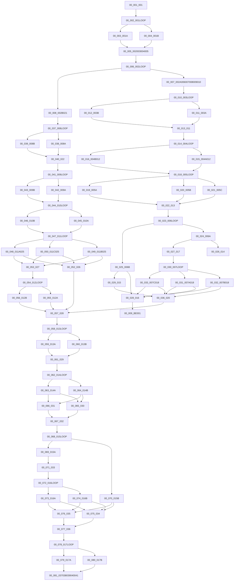

# 0 大风起

[返回目录](../README.md)

按图的拓扑顺序列出全部节点。并列分支不是连续发生的剧情；点击节点查看对白、前驱和后继。

## 节点与剧本

- [00_001_001](../nodes/00_001_001.md) 宣国晋王（字幕 40 条）
- [00_002_001LOOP](../nodes/00_002_001LOOP.md) 昂贵的玉（字幕 0 条）
- [00_003_001A](../nodes/00_003_001A.md) （字幕 2 条）
- [00_004_001B](../nodes/00_004_001B.md) （字幕 3 条）
- [00_005_002003004005](../nodes/00_005_002003004005.md) （字幕 65 条）
- [00_006_002LOOP](../nodes/00_006_002LOOP.md) 两个办法（字幕 0 条）
- [00_008_002B021](../nodes/00_008_002B021.md) （字幕 22 条）
- [00_007_002A006007008009010](../nodes/00_007_002A006007008009010.md) （字幕 40 条）
- [00_037_008LOOP](../nodes/00_037_008LOOP.md) 皇帝的近侍（字幕 0 条）
- [00_010_003LOOP](../nodes/00_010_003LOOP.md) 皇帝的近侍（字幕 0 条）
- [00_039_008B](../nodes/00_039_008B.md) （字幕 4 条）
- [00_038_008A](../nodes/00_038_008A.md) （字幕 14 条）
- [00_012_003B](../nodes/00_012_003B.md) （字幕 6 条）
- [00_011_003A](../nodes/00_011_003A.md) （字幕 14 条）
- [00_040_022](../nodes/00_040_022.md) （字幕 9 条）
- [00_013_011](../nodes/00_013_011.md) （字幕 7 条）
- [00_041_009LOOP](../nodes/00_041_009LOOP.md) 深夜进宫（字幕 0 条）
- [00_014_004LOOP](../nodes/00_014_004LOOP.md) 皇帝的召见（字幕 0 条）
- [00_043_009B](../nodes/00_043_009B.md) （字幕 7 条）
- [00_042_009A](../nodes/00_042_009A.md) （字幕 6 条）
- [00_016_004B012](../nodes/00_016_004B012.md) （字幕 7 条）
- [00_015_004A012](../nodes/00_015_004A012.md) （字幕 8 条）
- [00_044_010LOOP](../nodes/00_044_010LOOP.md) 求情的方法（字幕 0 条）
- [00_018_005LOOP](../nodes/00_018_005LOOP.md) 与虞宫的关系（字幕 0 条）
- [00_046_010B](../nodes/00_046_010B.md) （字幕 18 条）
- [00_045_010A](../nodes/00_045_010A.md) （字幕 30 条）
- [00_019_005A](../nodes/00_019_005A.md) （字幕 5 条）
- [00_020_005B](../nodes/00_020_005B.md) （字幕 20 条）
- [00_021_005C](../nodes/00_021_005C.md) （字幕 11 条）
- [00_047_011LOOP](../nodes/00_047_011LOOP.md) 处理逆臣（字幕 0 条）
- [00_022_013](../nodes/00_022_013.md) （字幕 5 条）
- [00_048_011A025](../nodes/00_048_011A025.md) （字幕 15 条）
- [00_050_011C025](../nodes/00_050_011C025.md) （字幕 33 条）
- [00_049_011B025](../nodes/00_049_011B025.md) （字幕 27 条）
- [00_023_006LOOP](../nodes/00_023_006LOOP.md) 是否在场（字幕 0 条）
- [00_053_027](../nodes/00_053_027.md) （字幕 4 条）
- [00_052_026](../nodes/00_052_026.md) （字幕 16 条）
- [00_025_006B](../nodes/00_025_006B.md) （字幕 5 条）
- [00_024_006A](../nodes/00_024_006A.md) （字幕 2 条）
- [00_054_012LOOP](../nodes/00_054_012LOOP.md) 皇帝的心思（字幕 0 条）
- [00_029_015](../nodes/00_029_015.md) （字幕 2 条）
- [00_027_017](../nodes/00_027_017.md) （字幕 3 条）
- [00_026_014](../nodes/00_026_014.md) （字幕 2 条）
- [00_056_012B](../nodes/00_056_012B.md) （字幕 28 条）
- [00_055_012A](../nodes/00_055_012A.md) （字幕 11 条）
- [00_030_007LOOP](../nodes/00_030_007LOOP.md) 放过虞宫的原因（字幕 0 条）
- [00_033_007C018](../nodes/00_033_007C018.md) （字幕 36 条）
- [00_031_007A018](../nodes/00_031_007A018.md) （字幕 9 条）
- [00_032_007B018](../nodes/00_032_007B018.md) （字幕 19 条）
- [00_028_016](../nodes/00_028_016.md) （字幕 6 条）
- [00_036_020](../nodes/00_036_020.md) （字幕 28 条）
- [00_009_BE001](../nodes/00_009_BE001.md) 天威难测（字幕 10 条）
- [00_057_028](../nodes/00_057_028.md) （字幕 38 条）
- [00_058_013LOOP](../nodes/00_058_013LOOP.md) 皇帝的棋局（字幕 0 条）
- [00_059_013A](../nodes/00_059_013A.md) （字幕 12 条）
- [00_060_013B](../nodes/00_060_013B.md) （字幕 18 条）
- [00_061_029](../nodes/00_061_029.md) （字幕 26 条）
- [00_062_014LOOP](../nodes/00_062_014LOOP.md) 犯错的大哥（字幕 0 条）
- [00_063_014A](../nodes/00_063_014A.md) （字幕 14 条）
- [00_064_014B](../nodes/00_064_014B.md) （字幕 13 条）
- [00_066_031](../nodes/00_066_031.md) （字幕 7 条）
- [00_065_030](../nodes/00_065_030.md) （字幕 9 条）
- [00_067_032](../nodes/00_067_032.md) （字幕 35 条）
- [00_068_015LOOP](../nodes/00_068_015LOOP.md) 替罪的羔羊（字幕 0 条）
- [00_069_015A](../nodes/00_069_015A.md) （字幕 10 条）
- [00_070_015B](../nodes/00_070_015B.md) （字幕 17 条）
- [00_071_033](../nodes/00_071_033.md) （字幕 2 条）
- [00_072_016LOOP](../nodes/00_072_016LOOP.md) 求救的棋子（字幕 0 条）
- [00_073_016A](../nodes/00_073_016A.md) （字幕 11 条）
- [00_074_016B](../nodes/00_074_016B.md) （字幕 6 条）
- [00_076_035](../nodes/00_076_035.md) （字幕 26 条）
- [00_075_034](../nodes/00_075_034.md) （字幕 29 条）
- [00_077_036](../nodes/00_077_036.md) （字幕 23 条）
- [00_078_017LOOP](../nodes/00_078_017LOOP.md) 宁王的警告（字幕 0 条）
- [00_079_017A](../nodes/00_079_017A.md) （字幕 2 条）
- [00_080_017B](../nodes/00_080_017B.md) （字幕 1 条）
- [00_081_037038039040041](../nodes/00_081_037038039040041.md) 大路独行（字幕 54 条）

## 全部连线

## 本章结局

- 天威难测 → [00_009_BE001](../nodes/00_009_BE001.md)；图上组合路径 96 条。