# 1 雨打萍

[返回目录](../README.md)

按图的拓扑顺序列出全部节点。并列分支不是连续发生的剧情；点击节点查看对白、前驱和后继。

## 节点与剧本

- [01_001_001](../nodes/01_001_001.md) 朝堂议事（字幕 57 条）
- [01_002_001LOOP](../nodes/01_002_001LOOP.md) 宁王的联姻（字幕 0 条）
- [01_003_001A](../nodes/01_003_001A.md) （字幕 0 条）
- [01_004_001B](../nodes/01_004_001B.md) （字幕 4 条）
- [01_005_002003004](../nodes/01_005_002003004.md) （字幕 78 条）
- [01_006_002LOOP](../nodes/01_006_002LOOP.md) 皇后的点心（字幕 0 条）
- [01_007_002A](../nodes/01_007_002A.md) （字幕 11 条）
- [01_009_002C](../nodes/01_009_002C.md) （字幕 12 条）
- [01_008_002B](../nodes/01_008_002B.md) （字幕 11 条）
- [01_010_005006](../nodes/01_010_005006.md) （字幕 23 条）
- [01_011_003LOOP](../nodes/01_011_003LOOP.md) 陈婉儿的心思（字幕 0 条）
- [01_012_003A007](../nodes/01_012_003A007.md) （字幕 13 条）
- [01_013_003B007](../nodes/01_013_003B007.md) （字幕 7 条）
- [01_014_004LOOP](../nodes/01_014_004LOOP.md) 陈氏长女（字幕 0 条）
- [01_016_004B](../nodes/01_016_004B.md) （字幕 17 条）
- [01_017_004C](../nodes/01_017_004C.md) （字幕 14 条）
- [01_015_004A](../nodes/01_015_004A.md) （字幕 24 条）
- [01_018_008009010011012](../nodes/01_018_008009010011012.md) （字幕 39 条）
- [01_019_005LOOP](../nodes/01_019_005LOOP.md) 私吞的物资（字幕 0 条）
- [01_020_005A](../nodes/01_020_005A.md) （字幕 5 条）
- [01_021_005B](../nodes/01_021_005B.md) （字幕 8 条）
- [01_022_013014015016017018](../nodes/01_022_013014015016017018.md) （字幕 54 条）
- [01_026_020](../nodes/01_026_020.md) （字幕 46 条）
- [01_023_006LOOP](../nodes/01_023_006LOOP.md) 突至的军队（字幕 0 条）
- [01_027_007LOOP](../nodes/01_027_007LOOP.md) 将错就错（字幕 0 条）
- [01_024_006A019](../nodes/01_024_006A019.md) （字幕 13 条）
- [01_025_006B019](../nodes/01_025_006B019.md) （字幕 8 条）
- [01_028_007A021_BE001](../nodes/01_028_007A021_BE001.md) 飞来横祸（字幕 23 条）
- [01_029_007B](../nodes/01_029_007B.md) （字幕 18 条）
- [01_033_037038](../nodes/01_033_037038.md) （字幕 21 条）
- [01_030_027](../nodes/01_030_027.md) （字幕 10 条）
- [01_034_008LOOP](../nodes/01_034_008LOOP.md) 落入牢狱（字幕 0 条）
- [01_031_028](../nodes/01_031_028.md) 大乱宫廷（字幕 5 条）
- [01_037_008C](../nodes/01_037_008C.md) （字幕 6 条）
- [01_035_008A](../nodes/01_035_008A.md) （字幕 7 条）
- [01_036_008B](../nodes/01_036_008B.md) （字幕 0 条）
- [01_032_032033034035036_HE001](../nodes/01_032_032033034035036_HE001.md) 气运之子（字幕 59 条）
- [01_080_029_BE002](../nodes/01_080_029_BE002.md) 时也命也（字幕 12 条）
- [01_038_039](../nodes/01_038_039.md) （字幕 28 条）
- [01_039_009LOOP](../nodes/01_039_009LOOP.md) 司空正的栽赃（字幕 0 条）
- [01_041_009B040](../nodes/01_041_009B040.md) （字幕 19 条）
- [01_040_009A040](../nodes/01_040_009A040.md) （字幕 11 条）
- [01_042_041042043](../nodes/01_042_041042043.md) （字幕 57 条）
- [01_043_010LOOP](../nodes/01_043_010LOOP.md) 脱罪的机会（字幕 0 条）
- [01_045_010B](../nodes/01_045_010B.md) （字幕 8 条）
- [01_044_010A](../nodes/01_044_010A.md) （字幕 14 条）
- [01_046_010C](../nodes/01_046_010C.md) （字幕 6 条）
- [01_047_044](../nodes/01_047_044.md) （字幕 44 条）
- [01_048_011LOOP](../nodes/01_048_011LOOP.md) 最后的通牒（字幕 0 条）
- [01_050_011B045](../nodes/01_050_011B045.md) （字幕 3 条）
- [01_049_011A](../nodes/01_049_011A.md) （字幕 8 条）
- [01_056_047048_BE003](../nodes/01_056_047048_BE003.md) 龙子稀薄（字幕 16 条）
- [01_055_046055](../nodes/01_055_046055.md) 晋王王妃（字幕 45 条）
- [01_051_049050052](../nodes/01_051_049050052.md) （字幕 28 条）
- [01_057_056](../nodes/01_057_056.md) （字幕 8 条）
- [01_058_058](../nodes/01_058_058.md) （字幕 22 条）
- [01_052_012LOOP](../nodes/01_052_012LOOP.md) 纷乱的时局（字幕 0 条）
- [01_059_013LOOP](../nodes/01_059_013LOOP.md) 破局的通路（字幕 0 条）
- [01_053_012A](../nodes/01_053_012A.md) 得道成仙（字幕 7 条）
- [01_054_012B053054](../nodes/01_054_012B053054.md) 我姓司空（字幕 11 条）
- [01_060_013A060](../nodes/01_060_013A060.md) （字幕 64 条）
- [01_061_013B](../nodes/01_061_013B.md) （字幕 6 条）
- [01_053_012A_HE](../nodes/01_053_012A_HE.md) （字幕 0 条）
- [01_062_014LOOP](../nodes/01_062_014LOOP.md) 儿有一言（字幕 0 条）
- [01_079_057_BE004](../nodes/01_079_057_BE004.md) 蝴蝶效应（字幕 9 条）
- [01_063_014A](../nodes/01_063_014A.md) （字幕 11 条）
- [01_064_014B](../nodes/01_064_014B.md) （字幕 11 条）
- [01_065_014C](../nodes/01_065_014C.md) （字幕 7 条）
- [01_066_061062](../nodes/01_066_061062.md) （字幕 35 条）
- [01_067_015LOOP](../nodes/01_067_015LOOP.md) 为何调兵（字幕 0 条）
- [01_068_015A](../nodes/01_068_015A.md) （字幕 31 条）
- [01_069_015B](../nodes/01_069_015B.md) （字幕 12 条）
- [01_070_015C_BE006](../nodes/01_070_015C_BE006.md) 朕也贪？（字幕 16 条）
- [01_071_063](../nodes/01_071_063.md) （字幕 9 条）
- [01_072_016LOOP](../nodes/01_072_016LOOP.md) 调兵之人（字幕 0 条）
- [01_074_016B](../nodes/01_074_016B.md) （字幕 13 条）
- [01_073_016A](../nodes/01_073_016A.md) （字幕 9 条）
- [01_075_064_BE007](../nodes/01_075_064_BE007.md) 揣摩圣意（字幕 11 条）
- [01_076_065](../nodes/01_076_065.md) （字幕 35 条）
- [01_084_017LOOP](../nodes/01_084_017LOOP.md) 定局（字幕 0 条）
- [01_085_066](../nodes/01_085_066.md) （字幕 64 条）
- [01_077_QTE2LOOP](../nodes/01_077_QTE2LOOP.md) 别故人（字幕 0 条）
- [01_078_066](../nodes/01_078_066.md) （字幕 0 条）
- [01_082_068](../nodes/01_082_068.md) （字幕 4 条）
- [01_081_067](../nodes/01_081_067.md) （字幕 2 条）
- [01_083_069079](../nodes/01_083_069079.md) 江北江南（字幕 39 条）

## 全部连线

```mermaid
flowchart TD
  n0["01_001_001"]
  n1["01_002_001LOOP"]
  n2["01_003_001A"]
  n3["01_004_001B"]
  n4["01_005_002003004"]
  n5["01_006_002LOOP"]
  n6["01_007_002A"]
  n7["01_009_002C"]
  n8["01_008_002B"]
  n9["01_010_005006"]
  n10["01_011_003LOOP"]
  n11["01_012_003A007"]
  n12["01_013_003B007"]
  n13["01_014_004LOOP"]
  n14["01_016_004B"]
  n15["01_017_004C"]
  n16["01_015_004A"]
  n17["01_018_008009010011012"]
  n18["01_019_005LOOP"]
  n19["01_020_005A"]
  n20["01_021_005B"]
  n21["01_022_013014015016017018"]
  n22["01_026_020"]
  n23["01_023_006LOOP"]
  n24["01_027_007LOOP"]
  n25["01_024_006A019"]
  n26["01_025_006B019"]
  n27["01_028_007A021_BE001"]
  n28["01_029_007B"]
  n29["01_033_037038"]
  n30["01_030_027"]
  n31["01_034_008LOOP"]
  n32["01_031_028"]
  n33["01_037_008C"]
  n34["01_035_008A"]
  n35["01_036_008B"]
  n36["01_032_032033034035036_HE001"]
  n37["01_080_029_BE002"]
  n38["01_038_039"]
  n39["01_039_009LOOP"]
  n40["01_041_009B040"]
  n41["01_040_009A040"]
  n42["01_042_041042043"]
  n43["01_043_010LOOP"]
  n44["01_045_010B"]
  n45["01_044_010A"]
  n46["01_046_010C"]
  n47["01_047_044"]
  n48["01_048_011LOOP"]
  n49["01_050_011B045"]
  n50["01_049_011A"]
  n51["01_056_047048_BE003"]
  n52["01_055_046055"]
  n53["01_051_049050052"]
  n54["01_057_056"]
  n55["01_058_058"]
  n56["01_052_012LOOP"]
  n57["01_059_013LOOP"]
  n58["01_053_012A"]
  n59["01_054_012B053054"]
  n60["01_060_013A060"]
  n61["01_061_013B"]
  n62["01_053_012A_HE"]
  n63["01_062_014LOOP"]
  n64["01_079_057_BE004"]
  n65["01_063_014A"]
  n66["01_064_014B"]
  n67["01_065_014C"]
  n68["01_066_061062"]
  n69["01_067_015LOOP"]
  n70["01_068_015A"]
  n71["01_069_015B"]
  n72["01_070_015C_BE006"]
  n73["01_071_063"]
  n74["01_072_016LOOP"]
  n75["01_074_016B"]
  n76["01_073_016A"]
  n77["01_075_064_BE007"]
  n78["01_076_065"]
  n79["01_084_017LOOP"]
  n80["01_085_066"]
  n81["01_077_QTE2LOOP"]
  n82["01_078_066"]
  n83["01_082_068"]
  n84["01_081_067"]
  n85["01_083_069079"]
  n86["02_001_001002003004"]
  n1 --> n2
  n5 --> n6
  n4 --> n5
  n2 --> n4
  n5 --> n7
  n5 --> n8
  n9 --> n10
  n7 --> n9
  n8 --> n9
  n6 --> n9
  n10 --> n11
  n10 --> n12
  n11 --> n13
  n12 --> n13
  n13 --> n14
  n13 --> n15
  n15 --> n17
  n14 --> n17
  n13 --> n16
  n16 --> n17
  n17 --> n18
  n19 --> n21
  n18 --> n19
  n18 --> n20
  n20 --> n22
  n22 --> n24
  n24 --> n27
  n24 --> n28
  n28 --> n30
  n30 --> n32
  n32 --> n36
  n32 --> n37
  n21 --> n23
  n25 --> n29
  n23 --> n25
  n33 --> n38
  n31 --> n33
  n31 --> n34
  n34 --> n38
  n29 --> n31
  n35 --> n38
  n31 --> n35
  n38 --> n39
  n39 --> n40
  n40 --> n42
  n43 --> n44
  n42 --> n43
  n41 --> n42
  n39 --> n41
  n43 --> n45
  n45 --> n47
  n44 --> n47
  n46 --> n47
  n43 --> n46
  n48 --> n49
  n58 --> n62
  n56 --> n58
  n53 --> n56
  n50 --> n53
  n56 --> n59
  n23 --> n26
  n26 --> n29
  n49 --> n51
  n49 --> n52
  n52 --> n54
  n55 --> n57
  n52 --> n55
  n60 --> n63
  n57 --> n60
  n54 --> n64
  n61 --> n64
  n57 --> n61
  n65 --> n68
  n63 --> n65
  n66 --> n68
  n63 --> n66
  n67 --> n68
  n63 --> n67
  n68 --> n69
  n70 --> n73
  n69 --> n70
  n69 --> n71
  n71 --> n73
  n74 --> n75
  n73 --> n74
  n69 --> n72
  n74 --> n76
  n76 --> n77
  n75 --> n77
  n76 --> n78
  n75 --> n78
  n82 --> n83
  n81 --> n82
  n80 --> n81
  n79 --> n80
  n78 --> n79
  n84 --> n85
  n83 --> n85
  n85 --> n86
  n82 --> n84
  n47 --> n48
  n48 --> n50
  n0 --> n1
  n3 --> n4
  n1 --> n3
```

## 本章结局

- 飞来横祸 → [01_028_007A021_BE001](../nodes/01_028_007A021_BE001.md)；图上组合路径 36 条。
- 气运之子 → [01_032_032033034035036_HE001](../nodes/01_032_032033034035036_HE001.md)；图上组合路径 36 条。
- 得道成仙 → [01_053_012A](../nodes/01_053_012A.md)；图上组合路径 1296 条。
- 我姓司空 → [01_054_012B053054](../nodes/01_054_012B053054.md)；图上组合路径 1296 条。
- 龙子稀薄 → [01_056_047048_BE003](../nodes/01_056_047048_BE003.md)；图上组合路径 1296 条。
- 朕也贪？ → [01_070_015C_BE006](../nodes/01_070_015C_BE006.md)；图上组合路径 3888 条。
- 揣摩圣意 → [01_075_064_BE007](../nodes/01_075_064_BE007.md)；图上组合路径 15552 条。
- 蝴蝶效应 → [01_079_057_BE004](../nodes/01_079_057_BE004.md)；图上组合路径 2592 条。
- 时也命也 → [01_080_029_BE002](../nodes/01_080_029_BE002.md)；图上组合路径 36 条。