# 2 蛟入海

[返回目录](../README.md)

按图的拓扑顺序列出全部节点。并列分支不是连续发生的剧情；点击节点查看对白、前驱和后继。

## 节点与剧本

- [02_001_001002003004](../nodes/02_001_001002003004.md) 风不止（字幕 61 条）
- [02_002_001LOOP](../nodes/02_002_001LOOP.md) 难得家宴（字幕 0 条）
- [02_003_001A](../nodes/02_003_001A.md) （字幕 15 条）
- [02_004_001B](../nodes/02_004_001B.md) （字幕 12 条）
- [02_005_005006](../nodes/02_005_005006.md) （字幕 33 条）
- [02_006_002LOOP](../nodes/02_006_002LOOP.md) 多少斤两（字幕 0 条）
- [02_008_002B](../nodes/02_008_002B.md) （字幕 1 条）
- [02_007_002A](../nodes/02_007_002A.md) （字幕 2 条）
- [02_009_007008](../nodes/02_009_007008.md) 玉韘何在（字幕 22 条）
- [02_010_009](../nodes/02_010_009.md) （字幕 18 条）
- [02_011_010015016](../nodes/02_011_010015016.md) （字幕 50 条）
- [02_012_003LOOP](../nodes/02_012_003LOOP.md) 赴宴的门道（字幕 0 条）
- [02_024_006LOOP](../nodes/02_024_006LOOP.md) 贵重之物（字幕 0 条）
- [02_014_003B](../nodes/02_014_003B.md) （字幕 9 条）
- [02_013_003A](../nodes/02_013_003A.md) （字幕 24 条）
- [02_026_006B](../nodes/02_026_006B.md) （字幕 17 条）
- [02_025_006A](../nodes/02_025_006A.md) （字幕 41 条）
- [02_019_013014](../nodes/02_019_013014.md) （字幕 35 条）
- [02_015_011012](../nodes/02_015_011012.md) （字幕 39 条）
- [02_020_005LOOP](../nodes/02_020_005LOOP.md) 两手空空（字幕 0 条）
- [02_016_004LOOP](../nodes/02_016_004LOOP.md) 寒碜的礼物（字幕 0 条）
- [02_022_005B](../nodes/02_022_005B.md) （字幕 21 条）
- [02_021_005A](../nodes/02_021_005A.md) （字幕 33 条）
- [02_023_005C](../nodes/02_023_005C.md) （字幕 24 条）
- [02_017_004A](../nodes/02_017_004A.md) （字幕 41 条）
- [02_018_004B](../nodes/02_018_004B.md) （字幕 36 条）
- [02_027_017](../nodes/02_027_017.md) 书生意气（字幕 12 条）
- [02_028_018](../nodes/02_028_018.md) （字幕 35 条）
- [02_029_019](../nodes/02_029_019.md) （字幕 37 条）
- [02_030_020](../nodes/02_030_020.md) （字幕 35 条）
- [02_031_007LOOP](../nodes/02_031_007LOOP.md) 祖月的挑战（字幕 0 条）
- [02_032_007A021](../nodes/02_032_007A021.md) （字幕 13 条）
- [02_033_007B039](../nodes/02_033_007B039.md) （字幕 23 条）
- [02_034_QTE1LOOP](../nodes/02_034_QTE1LOOP.md) 刀兵争锋（字幕 0 条）
- [02_053_008LOOP](../nodes/02_053_008LOOP.md) 身边的人才（字幕 0 条）
- [02_035_022](../nodes/02_035_022.md) （字幕 0 条）
- [02_055_008B](../nodes/02_055_008B.md) （字幕 1 条）
- [02_054_008A](../nodes/02_054_008A.md) （字幕 4 条）
- [02_036_QTE2](../nodes/02_036_QTE2.md) （字幕 0 条）
- [02_038_025](../nodes/02_038_025.md) （字幕 0 条）
- [02_039_024](../nodes/02_039_024.md) （字幕 0 条）
- [02_037_023](../nodes/02_037_023.md) （字幕 0 条）
- [02_041_027QTE3](../nodes/02_041_027QTE3.md) （字幕 0 条）
- [02_042_028](../nodes/02_042_028.md) （字幕 0 条）
- [02_043_029](../nodes/02_043_029.md) （字幕 0 条）
- [02_044_030QTE4](../nodes/02_044_030QTE4.md) （字幕 0 条）
- [02_046_032033](../nodes/02_046_032033.md) （字幕 0 条）
- [02_045_031](../nodes/02_045_031.md) （字幕 2 条）
- [02_047_QTE5](../nodes/02_047_QTE5.md) （字幕 0 条）
- [02_049_035](../nodes/02_049_035.md) （字幕 1 条）
- [02_048_034](../nodes/02_048_034.md) （字幕 0 条）
- [02_050_036](../nodes/02_050_036.md) （字幕 10 条）
- [02_051_037](../nodes/02_051_037.md) （字幕 21 条）
- [02_052_038_BE001](../nodes/02_052_038_BE001.md) 刀枪无眼（字幕 11 条）
- [02_056_040](../nodes/02_056_040.md) （字幕 48 条）
- [02_057_009LOOP](../nodes/02_057_009LOOP.md) 北伐之论（字幕 0 条）
- [02_058_009A](../nodes/02_058_009A.md) （字幕 33 条）
- [02_059_009B](../nodes/02_059_009B.md) （字幕 21 条）
- [02_060_041](../nodes/02_060_041.md) （字幕 9 条）
- [02_061_010LOOP](../nodes/02_061_010LOOP.md) 北伐的症结（字幕 0 条）
- [02_061_010LOOP_2](../nodes/02_061_010LOOP_2.md) （字幕 0 条）
- [02_062_010A](../nodes/02_062_010A.md) （字幕 15 条）
- [02_063_010B](../nodes/02_063_010B.md) （字幕 19 条）
- [02_064_010C](../nodes/02_064_010C.md) （字幕 11 条）
- [02_065_042](../nodes/02_065_042.md) （字幕 7 条）
- [02_066_011LOOP](../nodes/02_066_011LOOP.md) 失利之责（字幕 0 条）
- [02_068_011B](../nodes/02_068_011B.md) （字幕 7 条）
- [02_069_011C](../nodes/02_069_011C.md) （字幕 6 条）
- [02_067_011A](../nodes/02_067_011A.md) （字幕 26 条）
- [02_070_043](../nodes/02_070_043.md) 祖坤的意见（字幕 5 条）
- [02_071_044045046047_BE002](../nodes/02_071_044045046047_BE002.md) 孤勇者（字幕 35 条）
- [02_072_048049](../nodes/02_072_048049.md) （字幕 48 条）
- [02_073_012LOOP](../nodes/02_073_012LOOP.md) 醒酒汤（字幕 0 条）
- [02_074_012A](../nodes/02_074_012A.md) （字幕 27 条）
- [02_075_012B](../nodes/02_075_012B.md) （字幕 23 条）
- [02_076_050](../nodes/02_076_050.md) （字幕 2 条）
- [02_077_013LOOP](../nodes/02_077_013LOOP.md) 问君归期（字幕 0 条）
- [02_078_013A](../nodes/02_078_013A.md) （字幕 6 条）
- [02_079_013B](../nodes/02_079_013B.md) （字幕 4 条）
- [02_080_051](../nodes/02_080_051.md) 蛟龙入海（字幕 26 条）

## 图外字幕节点

- [02_032_007A021cc](../nodes/02_032_007A021cc.md)

## 全部连线

```mermaid
flowchart TD
  n0["02_001_001002003004"]
  n1["02_002_001LOOP"]
  n2["02_003_001A"]
  n3["02_004_001B"]
  n4["02_005_005006"]
  n5["02_006_002LOOP"]
  n6["02_008_002B"]
  n7["02_007_002A"]
  n8["02_009_007008"]
  n9["02_010_009"]
  n10["02_011_010015016"]
  n11["02_012_003LOOP"]
  n12["02_024_006LOOP"]
  n13["02_014_003B"]
  n14["02_013_003A"]
  n15["02_026_006B"]
  n16["02_025_006A"]
  n17["02_019_013014"]
  n18["02_015_011012"]
  n19["02_020_005LOOP"]
  n20["02_016_004LOOP"]
  n21["02_022_005B"]
  n22["02_021_005A"]
  n23["02_023_005C"]
  n24["02_017_004A"]
  n25["02_018_004B"]
  n26["02_027_017"]
  n27["02_028_018"]
  n28["02_029_019"]
  n29["02_030_020"]
  n30["02_031_007LOOP"]
  n31["02_032_007A021"]
  n32["02_033_007B039"]
  n33["02_034_QTE1LOOP"]
  n34["02_053_008LOOP"]
  n35["02_035_022"]
  n36["02_055_008B"]
  n37["02_054_008A"]
  n38["02_036_QTE2"]
  n39["02_038_025"]
  n40["02_039_024"]
  n41["02_037_023"]
  n42["02_041_027QTE3"]
  n43["02_042_028"]
  n44["02_043_029"]
  n45["02_044_030QTE4"]
  n46["02_046_032033"]
  n47["02_045_031"]
  n48["02_047_QTE5"]
  n49["02_049_035"]
  n50["02_048_034"]
  n51["02_050_036"]
  n52["02_051_037"]
  n53["02_052_038_BE001"]
  n54["02_056_040"]
  n55["02_057_009LOOP"]
  n56["02_058_009A"]
  n57["02_059_009B"]
  n58["02_060_041"]
  n59["02_061_010LOOP"]
  n60["02_061_010LOOP_2"]
  n61["02_062_010A"]
  n62["02_063_010B"]
  n63["02_064_010C"]
  n64["02_065_042"]
  n65["02_066_011LOOP"]
  n66["02_068_011B"]
  n67["02_069_011C"]
  n68["02_067_011A"]
  n69["02_070_043"]
  n70["02_071_044045046047_BE002"]
  n71["02_072_048049"]
  n72["02_073_012LOOP"]
  n73["02_074_012A"]
  n74["02_075_012B"]
  n75["02_076_050"]
  n76["02_077_013LOOP"]
  n77["02_078_013A"]
  n78["02_079_013B"]
  n79["02_080_051"]
  n80["03_001_001"]
  n1 --> n2
  n0 --> n1
  n1 --> n3
  n5 --> n6
  n6 --> n8
  n5 --> n7
  n7 --> n8
  n4 --> n5
  n2 --> n4
  n3 --> n4
  n8 --> n9
  n8 --> n10
  n11 --> n13
  n9 --> n11
  n14 --> n18
  n11 --> n14
  n13 --> n17
  n18 --> n20
  n17 --> n19
  n19 --> n21
  n23 --> n26
  n19 --> n22
  n21 --> n26
  n19 --> n23
  n20 --> n24
  n20 --> n25
  n24 --> n26
  n25 --> n26
  n22 --> n26
  n10 --> n12
  n12 --> n15
  n29 --> n30
  n27 --> n29
  n26 --> n27
  n28 --> n29
  n26 --> n28
  n33 --> n35
  n31 --> n33
  n30 --> n31
  n35 --> n38
  n38 --> n39
  n41 --> n42
  n39 --> n42
  n40 --> n42
  n38 --> n40
  n38 --> n41
  n42 --> n43
  n43 --> n45
  n44 --> n45
  n42 --> n44
  n46 --> n48
  n45 --> n46
  n48 --> n49
  n48 --> n50
  n49 --> n51
  n50 --> n51
  n49 --> n52
  n50 --> n52
  n49 --> n53
  n50 --> n53
  n30 --> n32
  n54 --> n55
  n16 --> n26
  n15 --> n26
  n12 --> n16
  n56 --> n58
  n55 --> n56
  n57 --> n58
  n55 --> n57
  n58 --> n59
  n59 --> n61
  n61 --> n64
  n62 --> n64
  n59 --> n62
  n63 --> n64
  n59 --> n63
  n58 --> n60
  n65 --> n66
  n65 --> n67
  n65 --> n68
  n69 --> n70
  n68 --> n69
  n66 --> n69
  n67 --> n69
  n64 --> n65
  n69 --> n71
  n72 --> n73
  n71 --> n72
  n72 --> n74
  n75 --> n76
  n73 --> n75
  n74 --> n75
  n77 --> n79
  n78 --> n79
  n79 --> n80
  n76 --> n77
  n76 --> n78
  n47 --> n51
  n47 --> n52
  n47 --> n53
  n45 --> n47
  n51 --> n54
  n32 --> n34
  n34 --> n36
  n36 --> n54
  n37 --> n54
  n34 --> n37
  n52 --> n54
```

## 本章结局

- 刀枪无眼 → [02_052_038_BE001](../nodes/02_052_038_BE001.md)；图上组合路径 1008 条。
- 孤勇者 → [02_071_044045046047_BE002](../nodes/02_071_044045046047_BE002.md)；图上组合路径 38304 条。