# 3 试锋刀

[返回目录](../README.md)

按图的拓扑顺序列出全部节点。并列分支不是连续发生的剧情；点击节点查看对白、前驱和后继。

## 节点与剧本

- [03_001_001](../nodes/03_001_001.md) 北征（字幕 34 条）
- [03_002_QTE1LOOP](../nodes/03_002_QTE1LOOP.md) （字幕 0 条）
- [03_003_002](../nodes/03_003_002.md) （字幕 22 条）
- [03_004_001LOOP](../nodes/03_004_001LOOP.md) 林间的青年（字幕 0 条）
- [03_005_001A](../nodes/03_005_001A.md) （字幕 3 条）
- [03_006_001B](../nodes/03_006_001B.md) （字幕 4 条）
- [03_007_003004](../nodes/03_007_003004.md) （字幕 35 条）
- [03_008_002LOOP](../nodes/03_008_002LOOP.md) 旧民的好意（字幕 0 条）
- [03_009_002A](../nodes/03_009_002A.md) （字幕 7 条）
- [03_010_002B](../nodes/03_010_002B.md) （字幕 10 条）
- [03_011_005006007008](../nodes/03_011_005006007008.md) （字幕 69 条）
- [03_012_003LOOP](../nodes/03_012_003LOOP.md) 弋阳的情况（字幕 0 条）
- [03_015_003C](../nodes/03_015_003C.md) （字幕 21 条）
- [03_013_003A](../nodes/03_013_003A.md) （字幕 20 条）
- [03_014_003B](../nodes/03_014_003B.md) （字幕 11 条）
- [03_016_003D](../nodes/03_016_003D.md) （字幕 27 条）
- [03_017_009010](../nodes/03_017_009010.md) （字幕 8 条）
- [03_018_004LOOP](../nodes/03_018_004LOOP.md) 宣国旧臣（字幕 0 条）
- [03_019_004A](../nodes/03_019_004A.md) （字幕 19 条）
- [03_020_004B](../nodes/03_020_004B.md) （字幕 13 条）
- [03_021_005LOOP](../nodes/03_021_005LOOP.md) 进城的请求（字幕 0 条）
- [03_022_005A](../nodes/03_022_005A.md) （字幕 3 条）
- [03_033_005A_1](../nodes/03_033_005A_1.md) （字幕 3 条）
- [03_023_005B](../nodes/03_023_005B.md) （字幕 7 条）
- [03_089_005B_1](../nodes/03_089_005B_1.md) （字幕 7 条）
- [03_027_014015](../nodes/03_027_014015.md) （字幕 76 条）
- [03_024_QTE2](../nodes/03_024_QTE2.md) 射杀叛臣（字幕 1 条）
- [03_028_006LOOP](../nodes/03_028_006LOOP.md) 传国宝玺（字幕 0 条）
- [03_025_012](../nodes/03_025_012.md) （字幕 3 条）
- [03_026_013](../nodes/03_026_013.md) （字幕 7 条）
- [03_029_006A016](../nodes/03_029_006A016.md) （字幕 21 条）
- [03_031_006C025](../nodes/03_031_006C025.md) （字幕 44 条）
- [03_030_006B024](../nodes/03_030_006B024.md) （字幕 67 条）
- [03_039_026](../nodes/03_039_026.md) （字幕 26 条）
- [03_040_027](../nodes/03_040_027.md) （字幕 38 条）
- [03_032_007LOOP](../nodes/03_032_007LOOP.md) 北上南归（字幕 0 条）
- [03_035_007B](../nodes/03_035_007B.md) （字幕 13 条）
- [03_034_007A017018_BE001](../nodes/03_034_007A017018_BE001.md) 亡国玉玺（字幕 38 条）
- [03_036_019020021022023](../nodes/03_036_019020021022023.md) （字幕 86 条）
- [03_041_028029030031032](../nodes/03_041_028029030031032.md) （字幕 20 条）
- [03_042_008LOOP](../nodes/03_042_008LOOP.md) 攻城的流民（字幕 0 条）
- [03_044_008B033](../nodes/03_044_008B033.md) （字幕 6 条）
- [03_043_008A](../nodes/03_043_008A.md) （字幕 21 条）
- [03_045_009LOOP](../nodes/03_045_009LOOP.md) 危机的城墙（字幕 0 条）
- [03_047_009B](../nodes/03_047_009B.md) （字幕 22 条）
- [03_046_009A034_BE002](../nodes/03_046_009A034_BE002.md) 是条汉子（字幕 24 条）
- [03_090_009C](../nodes/03_090_009C.md) （字幕 24 条）
- [03_048_035036037](../nodes/03_048_035036037.md) （字幕 28 条）
- [03_049_010LOOP](../nodes/03_049_010LOOP.md) 邬伖的主力（字幕 0 条）
- [03_051_010B038](../nodes/03_051_010B038.md) （字幕 16 条）
- [03_050_010A038](../nodes/03_050_010A038.md) （字幕 22 条）
- [03_052_011LOOP](../nodes/03_052_011LOOP.md) 夜袭的安排（字幕 0 条）
- [03_053_011A039](../nodes/03_053_011A039.md) （字幕 14 条）
- [03_054_011B042](../nodes/03_054_011B042.md) （字幕 7 条）
- [03_058_047048049050051052053](../nodes/03_058_047048049050051052053.md) （字幕 95 条）
- [03_055_040](../nodes/03_055_040.md) （字幕 0 条）
- [03_056_043](../nodes/03_056_043.md) （字幕 0 条）
- [03_057_045046_BE005](../nodes/03_057_045046_BE005.md) 用人不当（字幕 16 条）
- [03_059_012LOOP](../nodes/03_059_012LOOP.md) 突至的援手（字幕 0 条）
- [03_088_044_BE004](../nodes/03_088_044_BE004.md) 宣舞帝（字幕 24 条）
- [03_062_012B055056](../nodes/03_062_012B055056.md) （字幕 23 条）
- [03_060_012A054_BE006](../nodes/03_060_012A054_BE006.md) 奸细作乱（字幕 13 条）
- [03_063_013LOOP](../nodes/03_063_013LOOP.md) 安抚义士（字幕 0 条）
- [03_065_013B057057_1](../nodes/03_065_013B057057_1.md) （字幕 22 条）
- [03_064_013A_BE007](../nodes/03_064_013A_BE007.md) 大意殒命（字幕 2 条）
- [03_066_014LOOP](../nodes/03_066_014LOOP.md) 暴露的行踪（字幕 0 条）
- [03_067_014A](../nodes/03_067_014A.md) （字幕 4 条）
- [03_068_014B](../nodes/03_068_014B.md) （字幕 5 条）
- [03_069_058059060061062](../nodes/03_069_058059060061062.md) （字幕 75 条）
- [03_070_015LOOP](../nodes/03_070_015LOOP.md) 义军的嫌疑（字幕 0 条）
- [03_071_015A](../nodes/03_071_015A.md) （字幕 8 条）
- [03_072_015B](../nodes/03_072_015B.md) （字幕 12 条）
- [03_073_063](../nodes/03_073_063.md) （字幕 9 条）
- [03_074_016LOOP](../nodes/03_074_016LOOP.md) 义军的接收（字幕 0 条）
- [03_075_016A064065](../nodes/03_075_016A064065.md) （字幕 32 条）
- [03_076_016B066](../nodes/03_076_016B066.md) （字幕 48 条）
- [03_077_067068](../nodes/03_077_067068.md) （字幕 21 条）
- [03_078_017LOOP](../nodes/03_078_017LOOP.md) 城上的曲子（字幕 0 条）
- [03_079_017A](../nodes/03_079_017A.md) （字幕 22 条）
- [03_080_017B](../nodes/03_080_017B.md) （字幕 26 条）
- [03_082_069](../nodes/03_082_069.md) （字幕 16 条）
- [03_090_QTE3LOOP](../nodes/03_090_QTE3LOOP.md) （字幕 0 条）
- [03_091_069_1](../nodes/03_091_069_1.md) （字幕 3 条）
- [03_083_018LOOP](../nodes/03_083_018LOOP.md) 强大的敌人（字幕 0 条）
- [03_084_018A](../nodes/03_084_018A.md) （字幕 7 条）
- [03_085_018B](../nodes/03_085_018B.md) （字幕 6 条）
- [03_086_018C](../nodes/03_086_018C.md) （字幕 6 条）
- [03_087_070](../nodes/03_087_070.md) 望北（字幕 6 条）

## 全部连线

```mermaid
flowchart TD
  n0["03_001_001"]
  n1["03_002_QTE1LOOP"]
  n2["03_003_002"]
  n3["03_004_001LOOP"]
  n4["03_005_001A"]
  n5["03_006_001B"]
  n6["03_007_003004"]
  n7["03_008_002LOOP"]
  n8["03_009_002A"]
  n9["03_010_002B"]
  n10["03_011_005006007008"]
  n11["03_012_003LOOP"]
  n12["03_015_003C"]
  n13["03_013_003A"]
  n14["03_014_003B"]
  n15["03_016_003D"]
  n16["03_017_009010"]
  n17["03_018_004LOOP"]
  n18["03_019_004A"]
  n19["03_020_004B"]
  n20["03_021_005LOOP"]
  n21["03_022_005A"]
  n22["03_033_005A_1"]
  n23["03_023_005B"]
  n24["03_089_005B_1"]
  n25["03_027_014015"]
  n26["03_024_QTE2"]
  n27["03_028_006LOOP"]
  n28["03_025_012"]
  n29["03_026_013"]
  n30["03_029_006A016"]
  n31["03_031_006C025"]
  n32["03_030_006B024"]
  n33["03_039_026"]
  n34["03_040_027"]
  n35["03_032_007LOOP"]
  n36["03_035_007B"]
  n37["03_034_007A017018_BE001"]
  n38["03_036_019020021022023"]
  n39["03_041_028029030031032"]
  n40["03_042_008LOOP"]
  n41["03_044_008B033"]
  n42["03_043_008A"]
  n43["03_045_009LOOP"]
  n44["03_047_009B"]
  n45["03_046_009A034_BE002"]
  n46["03_090_009C"]
  n47["03_048_035036037"]
  n48["03_049_010LOOP"]
  n49["03_051_010B038"]
  n50["03_050_010A038"]
  n51["03_052_011LOOP"]
  n52["03_053_011A039"]
  n53["03_054_011B042"]
  n54["03_058_047048049050051052053"]
  n55["03_055_040"]
  n56["03_056_043"]
  n57["03_057_045046_BE005"]
  n58["03_059_012LOOP"]
  n59["03_088_044_BE004"]
  n60["03_062_012B055056"]
  n61["03_060_012A054_BE006"]
  n62["03_063_013LOOP"]
  n63["03_065_013B057057_1"]
  n64["03_064_013A_BE007"]
  n65["03_066_014LOOP"]
  n66["03_067_014A"]
  n67["03_068_014B"]
  n68["03_069_058059060061062"]
  n69["03_070_015LOOP"]
  n70["03_071_015A"]
  n71["03_072_015B"]
  n72["03_073_063"]
  n73["03_074_016LOOP"]
  n74["03_075_016A064065"]
  n75["03_076_016B066"]
  n76["03_077_067068"]
  n77["03_078_017LOOP"]
  n78["03_079_017A"]
  n79["03_080_017B"]
  n80["03_082_069"]
  n81["03_090_QTE3LOOP"]
  n82["03_091_069_1"]
  n83["03_083_018LOOP"]
  n84["03_084_018A"]
  n85["03_085_018B"]
  n86["03_086_018C"]
  n87["03_087_070"]
  n88["04_001_001002"]
  n4 --> n6
  n3 --> n4
  n2 --> n3
  n1 --> n2
  n0 --> n1
  n5 --> n6
  n3 --> n5
  n6 --> n7
  n8 --> n10
  n7 --> n8
  n9 --> n10
  n7 --> n9
  n10 --> n11
  n11 --> n12
  n11 --> n13
  n12 --> n16
  n13 --> n16
  n14 --> n16
  n11 --> n14
  n11 --> n15
  n16 --> n17
  n15 --> n16
  n17 --> n18
  n19 --> n20
  n18 --> n20
  n17 --> n19
  n20 --> n21
  n21 --> n25
  n25 --> n27
  n22 --> n25
  n20 --> n22
  n20 --> n23
  n23 --> n26
  n24 --> n26
  n20 --> n24
  n27 --> n30
  n35 --> n36
  n30 --> n35
  n27 --> n31
  n27 --> n32
  n36 --> n38
  n35 --> n37
  n38 --> n39
  n31 --> n39
  n32 --> n39
  n26 --> n28
  n28 --> n33
  n26 --> n29
  n29 --> n34
  n34 --> n39
  n33 --> n39
  n39 --> n40
  n43 --> n44
  n40 --> n41
  n41 --> n43
  n43 --> n45
  n42 --> n47
  n44 --> n47
  n40 --> n42
  n46 --> n47
  n43 --> n46
  n47 --> n48
  n48 --> n49
  n48 --> n50
  n50 --> n51
  n49 --> n51
  n52 --> n54
  n51 --> n52
  n51 --> n53
  n52 --> n55
  n53 --> n56
  n56 --> n59
  n55 --> n59
  n53 --> n57
  n54 --> n58
  n60 --> n62
  n58 --> n60
  n58 --> n61
  n63 --> n65
  n62 --> n63
  n62 --> n64
  n66 --> n68
  n65 --> n66
  n67 --> n68
  n65 --> n67
  n69 --> n70
  n68 --> n69
  n70 --> n72
  n71 --> n72
  n69 --> n71
  n72 --> n73
  n73 --> n74
  n75 --> n76
  n73 --> n75
  n78 --> n80
  n77 --> n78
  n76 --> n77
  n74 --> n76
  n79 --> n80
  n77 --> n79
  n84 --> n87
  n83 --> n84
  n81 --> n82
  n85 --> n87
  n83 --> n85
  n82 --> n83
  n80 --> n81
  n86 --> n87
  n87 --> n88
  n83 --> n86
```

## 本章结局

- 亡国玉玺 → [03_034_007A017018_BE001](../nodes/03_034_007A017018_BE001.md)；图上组合路径 64 条。
- 是条汉子 → [03_046_009A034_BE002](../nodes/03_046_009A034_BE002.md)；图上组合路径 320 条。
- 用人不当 → [03_057_045046_BE005](../nodes/03_057_045046_BE005.md)；图上组合路径 1920 条。
- 奸细作乱 → [03_060_012A054_BE006](../nodes/03_060_012A054_BE006.md)；图上组合路径 1920 条。
- 大意殒命 → [03_064_013A_BE007](../nodes/03_064_013A_BE007.md)；图上组合路径 1920 条。
- 宣舞帝 → [03_088_044_BE004](../nodes/03_088_044_BE004.md)；图上组合路径 3840 条。