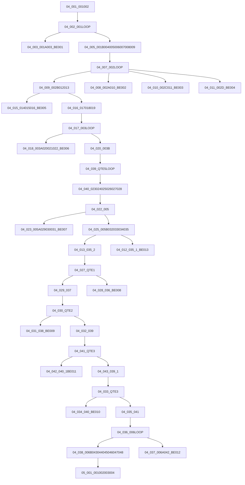

# 4 破山缺

[返回目录](../README.md)

按图的拓扑顺序列出全部节点。并列分支不是连续发生的剧情；点击节点查看对白、前驱和后继。

## 节点与剧本

- [04_001_001002](../nodes/04_001_001002.md) 受困弋阳（字幕 56 条）
- [04_002_001LOOP](../nodes/04_002_001LOOP.md) 援军的虚实（字幕 0 条）
- [04_003_001A003_BE001](../nodes/04_003_001A003_BE001.md) 回马枪（字幕 13 条）
- [04_005_001B004005006007008009](../nodes/04_005_001B004005006007008009.md) （字幕 92 条）
- [04_007_002LOOP](../nodes/04_007_002LOOP.md) 左支右绌（字幕 0 条）
- [04_009_002B012013](../nodes/04_009_002B012013.md) 驰援城南（字幕 25 条）
- [04_008_002A010_BE002](../nodes/04_008_002A010_BE002.md) 逍遥王（字幕 37 条）
- [04_010_002C011_BE003](../nodes/04_010_002C011_BE003.md) 常跑冠军（字幕 17 条）
- [04_011_002D_BE004](../nodes/04_011_002D_BE004.md) 城南失火（字幕 5 条）
- [04_015_014015016_BE005](../nodes/04_015_014015016_BE005.md) 死道友不死贫道（字幕 13 条）
- [04_016_017018019](../nodes/04_016_017018019.md) （字幕 13 条）
- [04_017_003LOOP](../nodes/04_017_003LOOP.md) 败局（字幕 0 条）
- [04_018_003A020021022_BE006](../nodes/04_018_003A020021022_BE006.md) 罪在儿臣（字幕 23 条）
- [04_020_003B](../nodes/04_020_003B.md) （字幕 59 条）
- [04_039_QTE5LOOP](../nodes/04_039_QTE5LOOP.md) （字幕 0 条）
- [04_040_023024025026027028](../nodes/04_040_023024025026027028.md) （字幕 80 条）
- [04_022_005](../nodes/04_022_005.md) 突入敌营（字幕 0 条）
- [04_023_005A029030031_BE007](../nodes/04_023_005A029030031_BE007.md) 技低一筹（字幕 15 条）
- [04_025_005B032033034035](../nodes/04_025_005B032033034035.md) （字幕 6 条）
- [04_013_035_2](../nodes/04_013_035_2.md) 搏杀（字幕 0 条）
- [04_012_035_1_BE013](../nodes/04_012_035_1_BE013.md) 武艺不精（字幕 0 条）
- [04_027_QTE1](../nodes/04_027_QTE1.md) （字幕 0 条）
- [04_029_037](../nodes/04_029_037.md) （字幕 0 条）
- [04_028_036_BE008](../nodes/04_028_036_BE008.md) （字幕 0 条）
- [04_030_QTE2](../nodes/04_030_QTE2.md) （字幕 0 条）
- [04_031_038_BE009](../nodes/04_031_038_BE009.md) （字幕 0 条）
- [04_032_039](../nodes/04_032_039.md) （字幕 11 条）
- [04_041_QTE3](../nodes/04_041_QTE3.md) （字幕 0 条）
- [04_042_040_1BE011](../nodes/04_042_040_1BE011.md) 抱错大腿（字幕 0 条）
- [04_043_039_1](../nodes/04_043_039_1.md) 断刃（字幕 0 条）
- [04_033_QTE3](../nodes/04_033_QTE3.md) （字幕 0 条）
- [04_034_040_BE010](../nodes/04_034_040_BE010.md) （字幕 0 条）
- [04_035_041](../nodes/04_035_041.md) （字幕 19 条）
- [04_036_006LOOP](../nodes/04_036_006LOOP.md) 何许人也（字幕 0 条）
- [04_038_006B043044045046047048](../nodes/04_038_006B043044045046047048.md) 王府喜事（字幕 100 条）
- [04_037_006A042_BE012](../nodes/04_037_006A042_BE012.md) （字幕 22 条）

## 全部连线

## 本章结局

- 回马枪 → [04_003_001A003_BE001](../nodes/04_003_001A003_BE001.md)；图上组合路径 1 条。
- 逍遥王 → [04_008_002A010_BE002](../nodes/04_008_002A010_BE002.md)；图上组合路径 1 条。
- 常跑冠军 → [04_010_002C011_BE003](../nodes/04_010_002C011_BE003.md)；图上组合路径 1 条。
- 城南失火 → [04_011_002D_BE004](../nodes/04_011_002D_BE004.md)；图上组合路径 1 条。
- 武艺不精 → [04_012_035_1_BE013](../nodes/04_012_035_1_BE013.md)；图上组合路径 1 条。
- 死道友不死贫道 → [04_015_014015016_BE005](../nodes/04_015_014015016_BE005.md)；图上组合路径 1 条。
- 罪在儿臣 → [04_018_003A020021022_BE006](../nodes/04_018_003A020021022_BE006.md)；图上组合路径 1 条。
- 技低一筹 → [04_023_005A029030031_BE007](../nodes/04_023_005A029030031_BE007.md)；图上组合路径 1 条。
- 身手欠佳 → [04_028_036_BE008](../nodes/04_028_036_BE008.md)；图上组合路径 1 条。
- 花拳绣腿 → [04_031_038_BE009](../nodes/04_031_038_BE009.md)；图上组合路径 1 条。
- 一寸长一寸强 → [04_034_040_BE010](../nodes/04_034_040_BE010.md)；图上组合路径 1 条。
- 功亏一篑 → [04_037_006A042_BE012](../nodes/04_037_006A042_BE012.md)；图上组合路径 1 条。
- 抱错大腿 → [04_042_040_1BE011](../nodes/04_042_040_1BE011.md)；图上组合路径 1 条。