# 5 问天命

[返回目录](../README.md)

按图的拓扑顺序列出全部节点。并列分支不是连续发生的剧情；点击节点查看对白、前驱和后继。

## 节点与剧本

- [05_001_001002003004](../nodes/05_001_001002003004.md) 将军去（字幕 69 条）
- [05_002_001LOOP](../nodes/05_002_001LOOP.md) 为何而争（字幕 0 条）
- [05_003_001A](../nodes/05_003_001A.md) （字幕 7 条）
- [05_004_001B](../nodes/05_004_001B.md) （字幕 3 条）
- [05_005_001C](../nodes/05_005_001C.md) （字幕 4 条）
- [05_006_005006007008](../nodes/05_006_005006007008.md) （字幕 66 条）
- [05_007_002LOOP](../nodes/05_007_002LOOP.md) 皇城急信（字幕 0 条）
- [05_008_002A](../nodes/05_008_002A.md) （字幕 8 条）
- [05_009_002B](../nodes/05_009_002B.md) （字幕 8 条）
- [05_010_009](../nodes/05_010_009.md) （字幕 6 条）
- [05_011_003LOOP](../nodes/05_011_003LOOP.md) 速速归京（字幕 0 条）
- [05_013_003B011](../nodes/05_013_003B011.md) （字幕 6 条）
- [05_012_003A010_BE001](../nodes/05_012_003A010_BE001.md) 兄友弟恭（字幕 30 条）
- [05_015_004LOOP](../nodes/05_015_004LOOP.md) 诏书的意思（字幕 0 条）
- [05_017_004B013014](../nodes/05_017_004B013014.md) （字幕 46 条）
- [05_016_004A012_BE002](../nodes/05_016_004A012_BE002.md) 黄粱美梦（字幕 32 条）
- [05_020_005LOOP](../nodes/05_020_005LOOP.md) 兵部的调令（字幕 0 条）
- [05_022_005B016_BE003](../nodes/05_022_005B016_BE003.md) 打草惊蛇（字幕 32 条）
- [05_021_005A015017018019](../nodes/05_021_005A015017018019.md) （字幕 109 条）
- [05_024_006LOOP](../nodes/05_024_006LOOP.md) 以下犯上（字幕 0 条）
- [05_026_006A](../nodes/05_026_006A.md) （字幕 16 条）
- [05_025_006B_BE004](../nodes/05_025_006B_BE004.md) 犹豫就会败北（字幕 24 条）
- [05_014_QTE5LOOP](../nodes/05_014_QTE5LOOP.md) （字幕 0 条）
- [05_018_020021022](../nodes/05_018_020021022.md) （字幕 28 条）
- [05_029_007LOOP](../nodes/05_029_007LOOP.md) 天命在我（字幕 0 条）
- [05_031_007B](../nodes/05_031_007B.md) （字幕 5 条）
- [05_030_007A](../nodes/05_030_007A.md) （字幕 5 条）
- [05_032_023024025](../nodes/05_032_023024025.md) （字幕 51 条）
- [05_033_008LOOP](../nodes/05_033_008LOOP.md) 大战将起（字幕 0 条）
- [05_035_008B026](../nodes/05_035_008B026.md) （字幕 8 条）
- [05_034_008A](../nodes/05_034_008A.md) （字幕 4 条）
- [05_036_009LOOP](../nodes/05_036_009LOOP.md) 安神的香（字幕 0 条）
- [05_039_009C](../nodes/05_039_009C.md) （字幕 2 条）
- [05_038_009B](../nodes/05_038_009B.md) （字幕 9 条）
- [05_037_009A](../nodes/05_037_009A.md) （字幕 3 条）
- [05_040_027028029030](../nodes/05_040_027028029030.md) （字幕 38 条）
- [05_041_010LOOP](../nodes/05_041_010LOOP.md) 紧迫的时间（字幕 0 条）
- [05_043_010B031](../nodes/05_043_010B031.md) （字幕 11 条）
- [05_042_010A_BE005](../nodes/05_042_010A_BE005.md) 不与为谋（字幕 15 条）
- [05_044_011LOOP](../nodes/05_044_011LOOP.md) 再见石狼（字幕 0 条）
- [05_046_011B](../nodes/05_046_011B.md) （字幕 2 条）
- [05_045_011A](../nodes/05_045_011A.md) （字幕 2 条）
- [05_023_032](../nodes/05_023_032.md) （字幕 17 条）
- [05_047_012LOOP](../nodes/05_047_012LOOP.md) 一笔生意（字幕 0 条）
- [05_048_012A_BE006](../nodes/05_048_012A_BE006.md) 不差钱（字幕 24 条）
- [05_049_012B033](../nodes/05_049_012B033.md) （字幕 14 条）
- [05_050_013LOOP](../nodes/05_050_013LOOP.md) 讨价还价（字幕 0 条）
- [05_052_013B](../nodes/05_052_013B.md) （字幕 20 条）
- [05_051_013A_BE007](../nodes/05_051_013A_BE007.md) 谈崩了（字幕 14 条）
- [05_053_034035](../nodes/05_053_034035.md) （字幕 19 条）
- [05_019_022LOOP](../nodes/05_019_022LOOP.md) 城下劝降（字幕 0 条）
- [05_027_022A](../nodes/05_027_022A.md) （字幕 16 条）
- [05_028_022B](../nodes/05_028_022B.md) （字幕 10 条）
- [05_067_036](../nodes/05_067_036.md) （字幕 5 条）
- [05_054_QTE2](../nodes/05_054_QTE2.md) （字幕 0 条）
- [05_056_038039](../nodes/05_056_038039.md) （字幕 45 条）
- [05_055_037_BE008](../nodes/05_055_037_BE008.md) 大功一箭（字幕 4 条）
- [05_057_014LOOP](../nodes/05_057_014LOOP.md) 破城（字幕 0 条）
- [05_058_014A040](../nodes/05_058_014A040.md) （字幕 17 条）
- [05_059_014B](../nodes/05_059_014B.md) （字幕 9 条）
- [05_061_042](../nodes/05_061_042.md) （字幕 19 条）
- [05_062_043](../nodes/05_062_043.md) （字幕 16 条）
- [05_063_044](../nodes/05_063_044.md) （字幕 9 条）
- [05_064_015LOOP](../nodes/05_064_015LOOP.md) 通敌罪证（字幕 0 条）
- [05_066_015B045](../nodes/05_066_015B045.md) （字幕 12 条）
- [05_065_015A](../nodes/05_065_015A.md) （字幕 10 条）
- [05_069_046047048049](../nodes/05_069_046047048049.md) （字幕 63 条）
- [05_070_016LOOP](../nodes/05_070_016LOOP.md) 意外来使（字幕 0 条）
- [05_072_016B055](../nodes/05_072_016B055.md) 假圣旨（字幕 8 条）
- [05_071_016A050051052053054](../nodes/05_071_016A050051052053054.md) 历史轮转（字幕 56 条）
- [05_075_056_BE009](../nodes/05_075_056_BE009.md) 分而化之（字幕 24 条）
- [05_076_057058059060061](../nodes/05_076_057058059060061.md) （字幕 77 条）
- [05_077_017LOOP](../nodes/05_077_017LOOP.md) 进退（字幕 0 条）
- [05_078_017A062](../nodes/05_078_017A062.md) （字幕 9 条）
- [05_079_017B](../nodes/05_079_017B.md) （字幕 7 条）
- [05_081_018LOOP](../nodes/05_081_018LOOP.md) 两难（字幕 0 条）
- [05_083_018B](../nodes/05_083_018B.md) （字幕 4 条）
- [05_082_018A_BE010](../nodes/05_082_018A_BE010.md) 被包饺子（字幕 3 条）
- [05_084_063064065066067068](../nodes/05_084_063064065066067068.md) （字幕 92 条）
- [05_085_019LOOP](../nodes/05_085_019LOOP.md) 胜者败者（字幕 0 条）
- [05_087_019B069](../nodes/05_087_019B069.md) （字幕 7 条）
- [05_086_019A](../nodes/05_086_019A.md) （字幕 7 条）
- [05_090_012LOOP](../nodes/05_090_012LOOP.md) 处置（字幕 0 条）
- [05_088_023LOOP](../nodes/05_088_023LOOP.md) 手足（字幕 0 条）
- [05_092_020B](../nodes/05_092_020B.md) （字幕 5 条）
- [05_091_020A](../nodes/05_091_020A.md) （字幕 3 条）
- [05_074_023AQTE4](../nodes/05_074_023AQTE4.md) （字幕 3 条）
- [05_089_023B](../nodes/05_089_023B.md) （字幕 3 条）
- [05_093_070](../nodes/05_093_070.md) （字幕 68 条）
- [05_094_021LOOP](../nodes/05_094_021LOOP.md) 软刀（字幕 0 条）
- [05_096_021A](../nodes/05_096_021A.md) （字幕 10 条）
- [05_095_021B_BE011](../nodes/05_095_021B_BE011.md) 宣泯帝（字幕 11 条）
- [05_097_071](../nodes/05_097_071.md) 天命（字幕 102 条）

## 图外字幕节点

- [05_013_003B](../nodes/05_013_003B.md)

## 全部连线

```mermaid
flowchart TD
  n0["05_001_001002003004"]
  n1["05_002_001LOOP"]
  n2["05_003_001A"]
  n3["05_004_001B"]
  n4["05_005_001C"]
  n5["05_006_005006007008"]
  n6["05_007_002LOOP"]
  n7["05_008_002A"]
  n8["05_009_002B"]
  n9["05_010_009"]
  n10["05_011_003LOOP"]
  n11["05_013_003B011"]
  n12["05_012_003A010_BE001"]
  n13["05_015_004LOOP"]
  n14["05_017_004B013014"]
  n15["05_016_004A012_BE002"]
  n16["05_020_005LOOP"]
  n17["05_022_005B016_BE003"]
  n18["05_021_005A015017018019"]
  n19["05_024_006LOOP"]
  n20["05_026_006A"]
  n21["05_025_006B_BE004"]
  n22["05_014_QTE5LOOP"]
  n23["05_018_020021022"]
  n24["05_029_007LOOP"]
  n25["05_031_007B"]
  n26["05_030_007A"]
  n27["05_032_023024025"]
  n28["05_033_008LOOP"]
  n29["05_035_008B026"]
  n30["05_034_008A"]
  n31["05_036_009LOOP"]
  n32["05_039_009C"]
  n33["05_038_009B"]
  n34["05_037_009A"]
  n35["05_040_027028029030"]
  n36["05_041_010LOOP"]
  n37["05_043_010B031"]
  n38["05_042_010A_BE005"]
  n39["05_044_011LOOP"]
  n40["05_046_011B"]
  n41["05_045_011A"]
  n42["05_023_032"]
  n43["05_047_012LOOP"]
  n44["05_048_012A_BE006"]
  n45["05_049_012B033"]
  n46["05_050_013LOOP"]
  n47["05_052_013B"]
  n48["05_051_013A_BE007"]
  n49["05_053_034035"]
  n50["05_019_022LOOP"]
  n51["05_027_022A"]
  n52["05_028_022B"]
  n53["05_067_036"]
  n54["05_054_QTE2"]
  n55["05_056_038039"]
  n56["05_055_037_BE008"]
  n57["05_057_014LOOP"]
  n58["05_058_014A040"]
  n59["05_059_014B"]
  n60["05_061_042"]
  n61["05_062_043"]
  n62["05_063_044"]
  n63["05_064_015LOOP"]
  n64["05_066_015B045"]
  n65["05_065_015A"]
  n66["05_069_046047048049"]
  n67["05_070_016LOOP"]
  n68["05_072_016B055"]
  n69["05_071_016A050051052053054"]
  n70["05_075_056_BE009"]
  n71["05_076_057058059060061"]
  n72["05_077_017LOOP"]
  n73["05_078_017A062"]
  n74["05_079_017B"]
  n75["05_081_018LOOP"]
  n76["05_083_018B"]
  n77["05_082_018A_BE010"]
  n78["05_084_063064065066067068"]
  n79["05_085_019LOOP"]
  n80["05_087_019B069"]
  n81["05_086_019A"]
  n82["05_090_012LOOP"]
  n83["05_088_023LOOP"]
  n84["05_092_020B"]
  n85["05_091_020A"]
  n86["05_074_023AQTE4"]
  n87["05_089_023B"]
  n88["05_093_070"]
  n89["05_094_021LOOP"]
  n90["05_096_021A"]
  n91["05_095_021B_BE011"]
  n92["05_097_071"]
  n93["06_001_001002003004005"]
  n0 --> n1
  n5 --> n6
  n2 --> n5
  n1 --> n2
  n3 --> n5
  n1 --> n3
  n4 --> n5
  n1 --> n4
  n9 --> n10
  n7 --> n9
  n6 --> n7
  n8 --> n9
  n6 --> n8
  n10 --> n11
  n13 --> n14
  n11 --> n13
  n10 --> n12
  n13 --> n15
  n16 --> n17
  n16 --> n18
  n14 --> n16
  n20 --> n22
  n22 --> n23
  n23 --> n24
  n19 --> n20
  n19 --> n21
  n18 --> n19
  n24 --> n25
  n26 --> n27
  n24 --> n26
  n35 --> n36
  n32 --> n35
  n31 --> n32
  n29 --> n31
  n28 --> n29
  n27 --> n28
  n25 --> n27
  n30 --> n35
  n28 --> n30
  n33 --> n35
  n31 --> n33
  n34 --> n35
  n31 --> n34
  n39 --> n40
  n37 --> n39
  n36 --> n37
  n36 --> n38
  n41 --> n42
  n39 --> n41
  n40 --> n42
  n43 --> n44
  n42 --> n43
  n46 --> n47
  n45 --> n46
  n43 --> n45
  n46 --> n48
  n49 --> n50
  n47 --> n49
  n53 --> n54
  n51 --> n53
  n50 --> n51
  n50 --> n52
  n52 --> n53
  n55 --> n57
  n54 --> n55
  n54 --> n56
  n57 --> n58
  n57 --> n59
  n60 --> n62
  n59 --> n60
  n58 --> n60
  n61 --> n62
  n58 --> n61
  n59 --> n61
  n63 --> n64
  n64 --> n66
  n67 --> n68
  n66 --> n67
  n62 --> n63
  n63 --> n65
  n65 --> n66
  n67 --> n69
  n68 --> n70
  n71 --> n72
  n68 --> n71
  n76 --> n78
  n75 --> n76
  n73 --> n75
  n72 --> n73
  n74 --> n78
  n72 --> n74
  n75 --> n77
  n84 --> n88
  n82 --> n84
  n80 --> n82
  n78 --> n79
  n83 --> n86
  n83 --> n87
  n81 --> n83
  n79 --> n80
  n79 --> n81
  n85 --> n88
  n82 --> n85
  n87 --> n88
  n86 --> n88
  n90 --> n92
  n92 --> n93
  n89 --> n90
  n88 --> n89
  n89 --> n91
```

## 本章结局

- 兄友弟恭 → [05_012_003A010_BE001](../nodes/05_012_003A010_BE001.md)；图上组合路径 6 条。
- 黄粱美梦 → [05_016_004A012_BE002](../nodes/05_016_004A012_BE002.md)；图上组合路径 6 条。
- 打草惊蛇 → [05_022_005B016_BE003](../nodes/05_022_005B016_BE003.md)；图上组合路径 6 条。
- 犹豫就会败北 → [05_025_006B_BE004](../nodes/05_025_006B_BE004.md)；图上组合路径 6 条。
- 不与为谋 → [05_042_010A_BE005](../nodes/05_042_010A_BE005.md)；图上组合路径 48 条。
- 不差钱 → [05_048_012A_BE006](../nodes/05_048_012A_BE006.md)；图上组合路径 96 条。
- 谈崩了 → [05_051_013A_BE007](../nodes/05_051_013A_BE007.md)；图上组合路径 96 条。
- 大功一箭 → [05_055_037_BE008](../nodes/05_055_037_BE008.md)；图上组合路径 192 条。
- 历史轮转 → [05_071_016A050051052053054](../nodes/05_071_016A050051052053054.md)；图上组合路径 1536 条。
- 分而化之 → [05_075_056_BE009](../nodes/05_075_056_BE009.md)；图上组合路径 1536 条。
- 被包饺子 → [05_082_018A_BE010](../nodes/05_082_018A_BE010.md)；图上组合路径 1536 条。
- 宣炀帝 → [05_095_021B_BE011](../nodes/05_095_021B_BE011.md)；图上组合路径 12288 条。