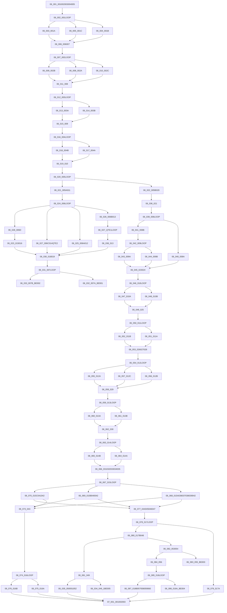

# 6 太平志

[返回目录](../README.md)

按图的拓扑顺序列出全部节点。并列分支不是连续发生的剧情；点击节点查看对白、前驱和后继。

## 节点与剧本

- [06_001_001002003004005](../nodes/06_001_001002003004005.md) 观沧海（字幕 82 条）
- [06_002_001LOOP](../nodes/06_002_001LOOP.md) 战术战略（字幕 0 条）
- [06_003_001A](../nodes/06_003_001A.md) （字幕 10 条）
- [06_005_001C](../nodes/06_005_001C.md) （字幕 11 条）
- [06_004_001B](../nodes/06_004_001B.md) （字幕 13 条）
- [06_006_006007](../nodes/06_006_006007.md) （字幕 50 条）
- [06_007_002LOOP](../nodes/06_007_002LOOP.md) 惊马（字幕 0 条）
- [06_009_002B](../nodes/06_009_002B.md) （字幕 3 条）
- [06_008_002A](../nodes/06_008_002A.md) （字幕 5 条）
- [06_010_002C](../nodes/06_010_002C.md) （字幕 4 条）
- [06_011_008](../nodes/06_011_008.md) （字幕 16 条）
- [06_012_003LOOP](../nodes/06_012_003LOOP.md) 刘静嫔（字幕 0 条）
- [06_013_003A](../nodes/06_013_003A.md) （字幕 5 条）
- [06_014_003B](../nodes/06_014_003B.md) （字幕 4 条）
- [06_015_009](../nodes/06_015_009.md) （字幕 44 条）
- [06_016_004LOOP](../nodes/06_016_004LOOP.md) 陈夫人（字幕 0 条）
- [06_018_004B](../nodes/06_018_004B.md) （字幕 16 条）
- [06_017_004A](../nodes/06_017_004A.md) （字幕 15 条）
- [06_019_010](../nodes/06_019_010.md) （字幕 38 条）
- [06_020_005LOOP](../nodes/06_020_005LOOP.md) 朝廷用度（字幕 0 条）
- [06_021_005A011](../nodes/06_021_005A011.md) （字幕 15 条）
- [06_022_005B020](../nodes/06_022_005B020.md) （字幕 107 条）
- [06_024_006LOOP](../nodes/06_024_006LOOP.md) 翻牌（字幕 0 条）
- [06_036_021](../nodes/06_036_021.md) （字幕 18 条）
- [06_028_006D](../nodes/06_028_006D.md) （字幕 10 条）
- [06_027_006C014QTE2](../nodes/06_027_006C014QTE2.md) （字幕 33 条）
- [06_025_006A012](../nodes/06_025_006A012.md) （字幕 16 条）
- [06_026_006B013](../nodes/06_026_006B013.md) （字幕 6 条）
- [06_039_008LOOP](../nodes/06_039_008LOOP.md) 访永宁侯（字幕 0 条）
- [06_023_015016](../nodes/06_023_015016.md) （字幕 29 条）
- [06_037_QTE1LOOP](../nodes/06_037_QTE1LOOP.md) （字幕 0 条）
- [06_041_008B](../nodes/06_041_008B.md) （字幕 23 条）
- [06_040_008A](../nodes/06_040_008A.md) （字幕 26 条）
- [06_038_013](../nodes/06_038_013.md) （字幕 7 条）
- [06_042_009LOOP](../nodes/06_042_009LOOP.md) 劝言（字幕 0 条）
- [06_030_018019](../nodes/06_030_018019.md) （字幕 23 条）
- [06_043_009A](../nodes/06_043_009A.md) （字幕 52 条）
- [06_044_009B](../nodes/06_044_009B.md) （字幕 43 条）
- [06_031_007LOOP](../nodes/06_031_007LOOP.md) 荒唐大梦（字幕 0 条）
- [06_045_023024](../nodes/06_045_023024.md) （字幕 24 条）
- [06_033_007B_BE002](../nodes/06_033_007B_BE002.md) 宣纵帝（字幕 11 条）
- [06_032_007A_BE001](../nodes/06_032_007A_BE001.md) 宣幽帝（字幕 26 条）
- [06_046_010LOOP](../nodes/06_046_010LOOP.md) 祭拜若兰（字幕 0 条）
- [06_047_010A](../nodes/06_047_010A.md) （字幕 8 条）
- [06_048_010B](../nodes/06_048_010B.md) （字幕 12 条）
- [06_049_025](../nodes/06_049_025.md) （字幕 11 条）
- [06_050_011LOOP](../nodes/06_050_011LOOP.md) 请赐老师（字幕 0 条）
- [06_052_011B](../nodes/06_052_011B.md) （字幕 5 条）
- [06_051_011A](../nodes/06_051_011A.md) （字幕 3 条）
- [06_053_026027028](../nodes/06_053_026027028.md) （字幕 88 条）
- [06_054_012LOOP](../nodes/06_054_012LOOP.md) 跋扈将军（字幕 0 条）
- [06_055_012A](../nodes/06_055_012A.md) （字幕 4 条）
- [06_057_012C](../nodes/06_057_012C.md) （字幕 4 条）
- [06_056_012B](../nodes/06_056_012B.md) （字幕 3 条）
- [06_058_029](../nodes/06_058_029.md) （字幕 16 条）
- [06_059_013LOOP](../nodes/06_059_013LOOP.md) 坊间谣言（字幕 0 条）
- [06_060_013A](../nodes/06_060_013A.md) （字幕 4 条）
- [06_061_013B](../nodes/06_061_013B.md) （字幕 3 条）
- [06_062_030](../nodes/06_062_030.md) （字幕 29 条）
- [06_063_014LOOP](../nodes/06_063_014LOOP.md) 用人（字幕 0 条）
- [06_065_014B](../nodes/06_065_014B.md) （字幕 10 条）
- [06_064_014A](../nodes/06_064_014A.md) （字幕 1 条）
- [06_066_031032033034035](../nodes/06_066_031032033034035.md) （字幕 104 条）
- [06_067_015LOOP](../nodes/06_067_015LOOP.md) 和亲（字幕 0 条）
- [06_070_015C041042](../nodes/06_070_015C041042.md) （字幕 19 条）
- [06_069_015B040042](../nodes/06_069_015B040042.md) （字幕 5 条）
- [06_068_015A036037038039042](../nodes/06_068_015A036037038039042.md) （字幕 13 条）
- [06_073_043](../nodes/06_073_043.md) （字幕 9 条）
- [06_077_044045046047](../nodes/06_077_044045046047.md) （字幕 47 条）
- [06_074_016LOOP](../nodes/06_074_016LOOP.md) 失败的变法（字幕 0 条）
- [06_078_017LOOP](../nodes/06_078_017LOOP.md) 受阻的变法（字幕 0 条）
- [06_076_016B](../nodes/06_076_016B.md) 敷衍（字幕 8 条）
- [06_075_016A](../nodes/06_075_016A.md) 隔阂（字幕 5 条）
- [06_080_017B048](../nodes/06_080_017B048.md) 一变到底（字幕 10 条）
- [06_079_017A](../nodes/06_079_017A.md) 罢手（字幕 4 条）
- [06_081_049](../nodes/06_081_049.md) 猜疑（字幕 10 条）
- [06_082_053054](../nodes/06_082_053054.md) 惶惶（字幕 16 条）
- [06_035_050051052](../nodes/06_035_050051052.md) 朱大将军（字幕 64 条）
- [06_034_049_1BE005](../nodes/06_034_049_1BE005.md) 帝星不明（字幕 16 条）
- [06_084_056](../nodes/06_084_056.md) （字幕 9 条）
- [06_083_055_BE003](../nodes/06_083_055_BE003.md) 宣废帝（字幕 23 条）
- [06_085_018LOOP](../nodes/06_085_018LOOP.md) 骑虎（字幕 0 条）
- [06_087_018B057058059060](../nodes/06_087_018B057058059060.md) 取舍（字幕 66 条）
- [06_086_018A_BE004](../nodes/06_086_018A_BE004.md) 宣殇帝（字幕 7 条）

## 全部连线

## 本章结局

- 宣幽帝 → [06_032_007A_BE001](../nodes/06_032_007A_BE001.md)；图上组合路径 144 条。
- 宣纵帝 → [06_033_007B_BE002](../nodes/06_033_007B_BE002.md)；图上组合路径 144 条。
- 帝星不明 → [06_034_049_1BE005](../nodes/06_034_049_1BE005.md)；图上组合路径 15552 条。
- 宣废帝 → [06_083_055_BE003](../nodes/06_083_055_BE003.md)；图上组合路径 15552 条。
- 宣殇帝 → [06_086_018A_BE004](../nodes/06_086_018A_BE004.md)；图上组合路径 15552 条。