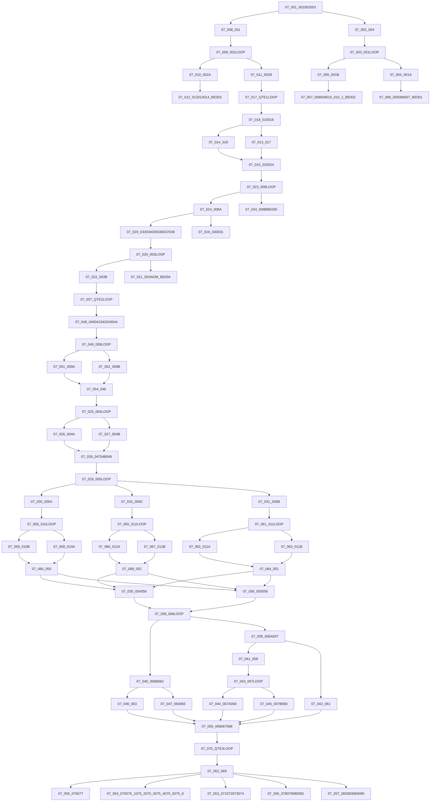

# 7 九州同

[返回目录](../README.md)

按图的拓扑顺序列出全部节点。并列分支不是连续发生的剧情；点击节点查看对白、前驱和后继。

## 节点与剧本

- [07_001_001002003](../nodes/07_001_001002003.md) 铁蹄南踏（字幕 47 条）
- [07_008_011](../nodes/07_008_011.md) （字幕 2 条）
- [07_002_004](../nodes/07_002_004.md) （字幕 5 条）
- [07_009_002LOOP](../nodes/07_009_002LOOP.md) 尚有一战（字幕 0 条）
- [07_003_001LOOP](../nodes/07_003_001LOOP.md) 勉励应对（字幕 0 条）
- [07_010_002A](../nodes/07_010_002A.md) （字幕 15 条）
- [07_011_002B](../nodes/07_011_002B.md) （字幕 29 条）
- [07_005_001B](../nodes/07_005_001B.md) （字幕 7 条）
- [07_004_001A](../nodes/07_004_001A.md) （字幕 6 条）
- [07_012_012013014_BE003](../nodes/07_012_012013014_BE003.md) 宣康帝（字幕 11 条）
- [07_017_QTE1LOOP](../nodes/07_017_QTE1LOOP.md) 挥师北伐（字幕 0 条）
- [07_007_008009010_010_1_BE002](../nodes/07_007_008009010_010_1_BE002.md) 宣哀帝（字幕 53 条）
- [07_006_005006007_BE001](../nodes/07_006_005006007_BE001.md) 宣怀帝（字幕 15 条）
- [07_018_015016](../nodes/07_018_015016.md) （字幕 17 条）
- [07_014_018](../nodes/07_014_018.md) （字幕 18 条）
- [07_013_017](../nodes/07_013_017.md) （字幕 17 条）
- [07_015_020024](../nodes/07_015_020024.md) （字幕 98 条）
- [07_023_008LOOP](../nodes/07_023_008LOOP.md) 后方之乱（字幕 0 条）
- [07_024_008A](../nodes/07_024_008A.md) 鸾凤鸣（字幕 95 条）
- [07_034_008BBE005](../nodes/07_034_008BBE005.md) 宣庄帝（字幕 52 条）
- [07_019_033034035036037038](../nodes/07_019_033034035036037038.md) （字幕 38 条）
- [07_016_030031](../nodes/07_016_030031.md) 宣明帝（字幕 41 条）
- [07_020_003LOOP](../nodes/07_020_003LOOP.md) 王对王（字幕 0 条）
- [07_022_003B](../nodes/07_022_003B.md) （字幕 2 条）
- [07_021_003A039_BE004](../nodes/07_021_003A039_BE004.md) 攻守又易形了（字幕 1 条）
- [07_037_QTE2LOOP](../nodes/07_037_QTE2LOOP.md) （字幕 0 条）
- [07_048_040041042043044](../nodes/07_048_040041042043044.md) （字幕 74 条）
- [07_049_009LOOP](../nodes/07_049_009LOOP.md) 谁当大任（字幕 0 条）
- [07_051_009A](../nodes/07_051_009A.md) （字幕 20 条）
- [07_052_009B](../nodes/07_052_009B.md) （字幕 19 条）
- [07_054_046](../nodes/07_054_046.md) （字幕 37 条）
- [07_025_004LOOP](../nodes/07_025_004LOOP.md) 君君臣臣（字幕 0 条）
- [07_026_004A](../nodes/07_026_004A.md) （字幕 11 条）
- [07_027_004B](../nodes/07_027_004B.md) （字幕 5 条）
- [07_028_047048049](../nodes/07_028_047048049.md) （字幕 8 条）
- [07_029_005LOOP](../nodes/07_029_005LOOP.md) 一瓢弱水（字幕 0 条）
- [07_030_005A](../nodes/07_030_005A.md) （字幕 5 条）
- [07_032_005C](../nodes/07_032_005C.md) （字幕 21 条）
- [07_031_005B](../nodes/07_031_005B.md) （字幕 16 条）
- [07_056_010LOOP](../nodes/07_056_010LOOP.md) 比翼鸟（字幕 0 条）
- [07_065_012LOOP](../nodes/07_065_012LOOP.md) 双飞燕（字幕 0 条）
- [07_061_011LOOP](../nodes/07_061_011LOOP.md) 连理枝（字幕 0 条）
- [07_059_010B](../nodes/07_059_010B.md) （字幕 6 条）
- [07_058_010A](../nodes/07_058_010A.md) （字幕 6 条）
- [07_066_012A](../nodes/07_066_012A.md) （字幕 3 条）
- [07_067_012B](../nodes/07_067_012B.md) （字幕 3 条）
- [07_062_011A](../nodes/07_062_011A.md) （字幕 13 条）
- [07_063_011B](../nodes/07_063_011B.md) （字幕 4 条）
- [07_060_050](../nodes/07_060_050.md) （字幕 7 条）
- [07_068_052](../nodes/07_068_052.md) （字幕 26 条）
- [07_064_051](../nodes/07_064_051.md) （字幕 10 条）
- [07_035_054056](../nodes/07_035_054056.md) （字幕 15 条）
- [07_036_055056](../nodes/07_036_055056.md) 传位诏（字幕 18 条）
- [07_038_006LOOP](../nodes/07_038_006LOOP.md) 传位诏（字幕 0 条）
- [07_040_006B062](../nodes/07_040_006B062.md) （字幕 6 条）
- [07_039_006A057](../nodes/07_039_006A057.md) （字幕 6 条）
- [07_046_063](../nodes/07_046_063.md) （字幕 33 条）
- [07_047_064065](../nodes/07_047_064065.md) （字幕 38 条）
- [07_041_058](../nodes/07_041_058.md) （字幕 13 条）
- [07_042_061](../nodes/07_042_061.md) （字幕 56 条）
- [07_043_007LOOP](../nodes/07_043_007LOOP.md) 父与子（字幕 0 条）
- [07_044_007A059](../nodes/07_044_007A059.md) （字幕 50 条）
- [07_045_007B060](../nodes/07_045_007B060.md) （字幕 46 条）
- [07_050_066067068](../nodes/07_050_066067068.md) 九州同（字幕 106 条）
- [07_070_QTE3LOOP](../nodes/07_070_QTE3LOOP.md) （字幕 0 条）
- [07_052_069](../nodes/07_052_069.md) （字幕 0 条）
- [07_055_076077](../nodes/07_055_076077.md) 宣文帝（字幕 68 条）
- [07_054_075075_1075_2075_3075_4075_5075_6](../nodes/07_054_075075_1075_2075_3075_4075_5075_6.md) 宣成帝（字幕 32 条）
- [07_053_071072073074](../nodes/07_053_071072073074.md) 宣景帝（字幕 42 条）
- [07_056_078079080081](../nodes/07_056_078079080081.md) 宣光武帝（字幕 41 条）
- [07_057_082083084085](../nodes/07_057_082083084085.md) 宣昭帝（字幕 37 条）

## 全部连线

## 本章结局

- 宣怀帝 → [07_006_005006007_BE001](../nodes/07_006_005006007_BE001.md)；图上组合路径 1 条。
- 宣哀帝 → [07_007_008009010_010_1_BE002](../nodes/07_007_008009010_010_1_BE002.md)；图上组合路径 1 条。
- 宣康帝 → [07_012_012013014_BE003](../nodes/07_012_012013014_BE003.md)；图上组合路径 1 条。
- 宣明帝 → [07_016_030031](../nodes/07_016_030031.md)；图上组合路径 2 条。
- 攻守又易形了 → [07_021_003A039_BE004](../nodes/07_021_003A039_BE004.md)；图上组合路径 2 条。
- 宣庄帝 → [07_034_008BBE005](../nodes/07_034_008BBE005.md)；图上组合路径 2 条。
- 宣景帝 → [07_053_071072073074](../nodes/07_053_071072073074.md)；图上组合路径 480 条。
- 宣成帝 → [07_054_075075_1075_2075_3075_4075_5075_6](../nodes/07_054_075075_1075_2075_3075_4075_5075_6.md)；图上组合路径 480 条。
- 宣文帝 → [07_055_076077](../nodes/07_055_076077.md)；图上组合路径 480 条。
- 宣光武帝 → [07_056_078079080081](../nodes/07_056_078079080081.md)；图上组合路径 480 条。
- 宣昭帝 → [07_057_082083084085](../nodes/07_057_082083084085.md)；图上组合路径 480 条。