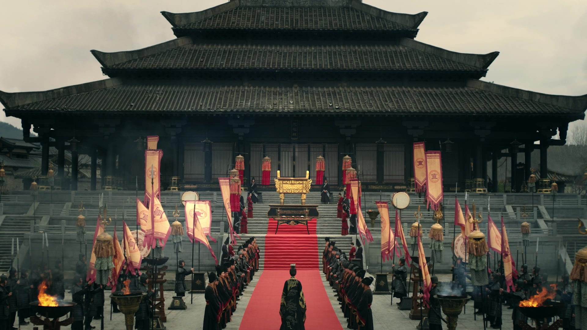
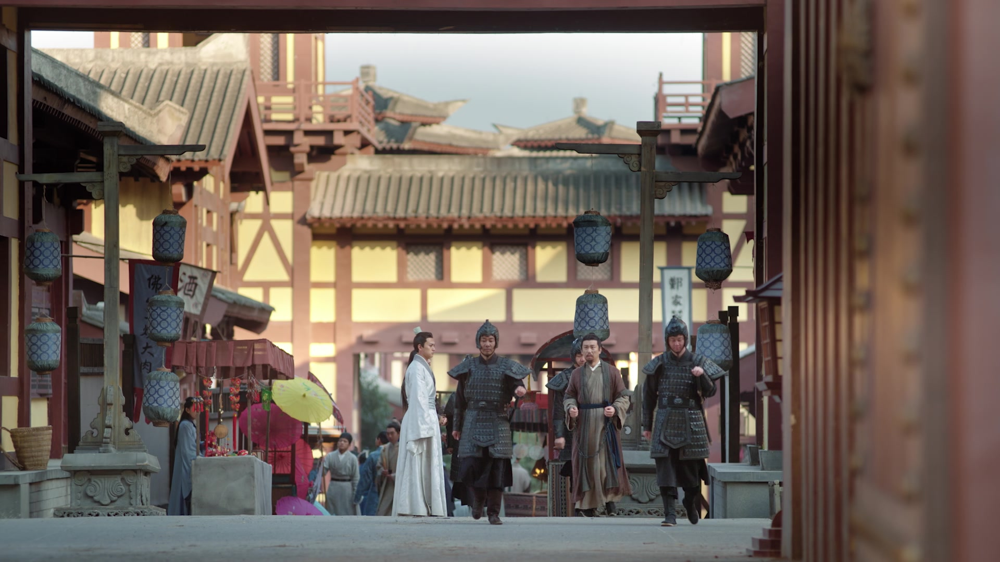
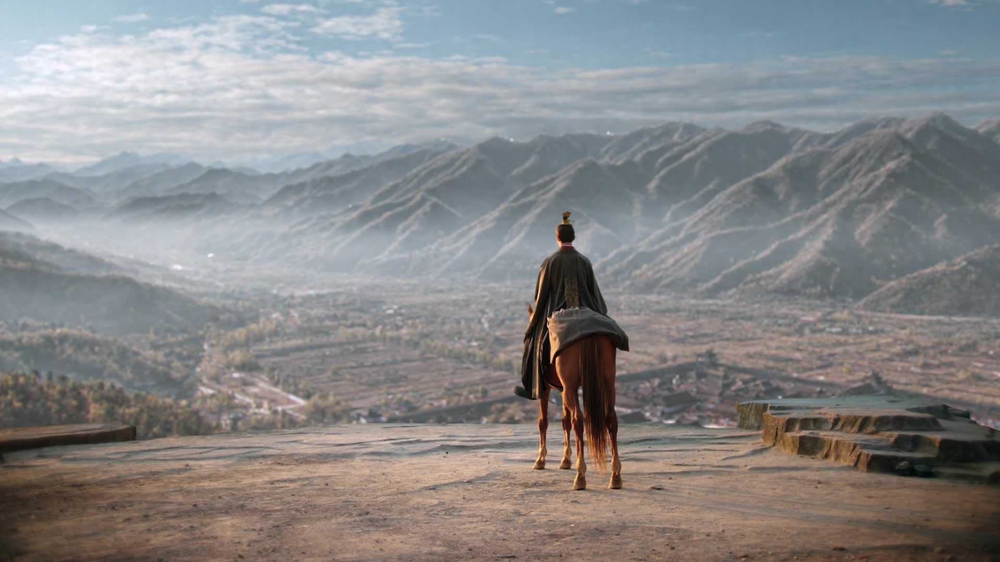
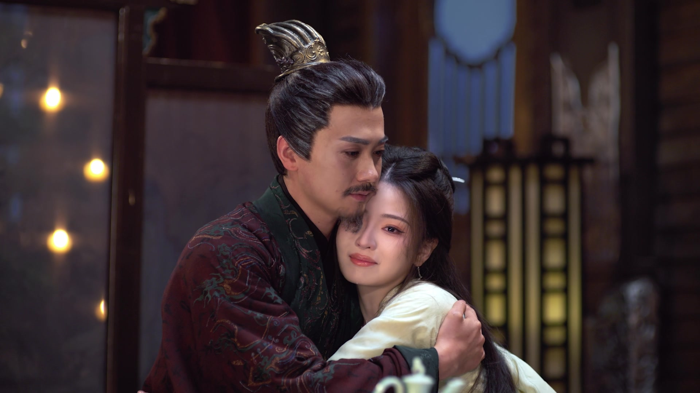

# 江山北望 开头与结尾影像风格及视频 Prompt

2026-11-17。本次从当前安装资源中的九段候选 MP4 抽帧筛选，最终选取四个视频文件中的四个镜头：两段来自序章，两段来自终章。三段以环境构图为重点，一段以人物为对照。其中只有 C 是山河自然远景，A、B 分别属于宫殿与街巷，不能统称为自然风光。

最值得优先复用的是 **C 的“前景骑者—中景城池—远景山脉”三层空间**。人物背向观众，把视线带向远方；景物承担叙事，人物提供尺度。A 的轴线宫殿与 B 的门框街巷适合补充空间语言，D 用来控制人物肤色、服装与室内光线。

## 1. 素材路径与取用范围

以下四份源文件均为 1920×1080、25 fps、H.264 视频，带 AAC 音轨。时间均相对于各自源 MP4，不是全游戏累计时间。

| 编号 | 位置与用途 | 源文件及完整时长 | 本次选用区间 | 可直接播放的节选 |
|---|---|---|---|---|
| A | 开头，宫殿建筑远景 | [00_001_001.mp4](候选原片/00_001_001.mp4)，107.16 秒 | 00:01.00–00:03.00 | [开篇宫殿](精选四段MP4/A-开篇宫殿.mp4)，2 秒 |
| B | 序章后段，街巷环境 | [00_075_034.mp4](候选原片/00_075_034.mp4)，148.40 秒 | 00:57.00–00:59.20 | [序章街巷](精选四段MP4/B-序章街巷.mp4)，2.2 秒 |
| C | 终章收束，山河与城池 | [07_050_066067068.mp4](候选原片/07_050_066067068.mp4)，369.92 秒 | 05:50.00–05:58.80 | [终章山河](精选四段MP4/C-终章山河.mp4)，8.8 秒 |
| D | 终章人物情感段落 | [07_068_052.mp4](候选原片/07_068_052.mp4)，146.80 秒 | 00:08.00–00:16.00 | [结尾人物](精选四段MP4/D-结尾人物.mp4)，8 秒 |

B 属于开篇章节，非游戏最初几秒；C、D 属于不同剧情片段，不能拼称唯一正史结局。四份完整源 MP4 均已提取；节选是另外生成的重编码阅读副本。A、B 的环境镜头本来很短，因此后文的 5–6 秒生成 Prompt 是创作性延长，不是原片时长复刻。

原始来源：`D:/SteamLibrary/steamapps/common/江山北望/chapter0_neutral.pack` 与 `chapter7_neutral.pack` 中的同名 `videos/*.mp4`。当前安装客户端为 2.0.4；这不等于能够证明每个视频都在 2.0.4 更新中发生过变化。源文件哈希、媒体参数和采样时间保存在 [初轮抽帧清单](抽帧清单.json)、[补充抽帧清单](补充抽帧清单.json)。

## 2. 总体风格判断

### 可以从画面直接确认的内容

- **建筑和服装以写实古装影视质感呈现。** 木构、瓦面、织物、冠饰、人物妆容均有具体细节；不是水墨动画或卡通渲染。
- **空间由前、中、后景组织。** A 用台阶、仪仗和宫殿形成纵深；B 用近处门框、中段行人和远处屋顶形成层次；C 用岩台、骑者、城池和山脉形成尺度递进。
- **主色不是全片统一的灰黄滤镜。** A 是偏暗的灰绿、土黄，加红毯和金色礼器；B 日光更明亮，有赭红木构、浅黄墙面与蓝灰灯笼；C 是灰蓝远山与暖灰土地；D 是深红、墨绿服饰和自然肤色，背景暖灯与冷色窗光并存。
- **画面大体克制，局部强调。** A 的红毯、D 的暖灯是视觉重点；C 的人物与马保留暖色，把视线固定在冷灰背景前。

### 只能作为判断或生成建议的内容

山河画面具有较大的纵深和较整齐的远方城市纹理，可能包含后期环境扩展，但仅凭成片不能确认采用了实景、数字绘景、三维或哪一种生成技术。摄影机型号、真实镜头焦距、灯具、LUT、原始提示词均无法从这些帧中反推为事实。

下面 Prompt 中的“缓慢推进”“固定机位”“5 秒”等，是为了复现观感而提出的控制方式，不是对原片拍摄参数的认定。所有 Prompt 均尚未送入生成模型测试。

## 3. A 开篇宫殿：用轴线和人物尺度建立权力感

**观察依据：** 原片 1.5、2.5 秒的构图相近。中央红毯从画面底部通向高台和金色座具；两侧仪仗排列，深色多重檐屋顶占据上半部。人物多，但单人尺度小，宫殿是主体。薄烟、火盆和旗帜使静态仪式空间有可动元素。3.5 秒已经出现向骑兵镜头的叠化，因此不能把它作为干净的建筑参考帧。

**风格拆解：** 正面轴线构图；灰绿瓦面与木构压暗；红毯形成清晰引导线；土黄天空和烟气缓和远近对比。庄严来自尺度和秩序，不需要额外堆砌巨型宫殿、飞龙或夸张金光。

**视频 Prompt，建议 5 秒，单镜头：**

> 16:9，写实古装历史影视画面。正面远景，一座深灰瓦、多重檐的大殿占据画面上半部，中央石阶和一条朱红地毯从前景通向高台；少量深色袍服仪仗人物站在两侧，人物保持小尺度，建筑始终是画面主体。阴天柔光，灰绿瓦面、暗木构、土黄色天空，金色礼器只作局部亮点。镜头稳定，沿中央轴线极缓慢靠近，5 秒内构图变化很小；两侧旗幡轻摆，火盆火焰小幅跳动，薄烟缓慢横移。石阶、屋檐和立柱保持结构稳定，不切镜，不变焦冲刺，不出现现代物件、额外文字或字幕。

**参考图用法：** 用 1.50 秒帧固定建筑比例和红毯方向。若优先保持建筑稳定，可把“极缓慢靠近”替换成“摄影机固定，仅旗帜、火焰和烟气运动”。不要同时要求前进、升高、环绕和拉远。

## 4. B 序章街巷：用门框和屋檐表现生活空间

**观察依据：** 57、58、59 秒均是透过门洞看街巷的远景，人物在下半部向前移动；60 秒已切到人物近景。右侧粗木柱和上方横梁形成画框，层层屋顶、灯笼、摊棚和伞面补充空间信息。它仍然是带人物的剧情镜头，并非无人空镜。

**风格拆解：** 视点较低，门内较暗、街面较亮；赭红梁柱、浅黄墙面、灰绿瓦和蓝灰灯笼形成柔和配色。建筑表面并非全都破败，不应一概写“废墟、脏污、荒凉”。

**视频 Prompt，建议 5 秒，环境优先改写：**

> 16:9，写实古装街巷。摄影机固定在深色木门内，右侧近处木柱和上方横梁形成自然画框，门外是一条有纵深的旧城街道。中景两侧是赭红木构、浅黄色灰泥墙和灰绿瓦屋顶，蓝灰色布灯笼悬在木架下，少量摊棚和纸伞点缀街边。温和日光照亮远处墙面，门内保持较暗，前后景亮度自然过渡。画面重点是街道、屋檐和灯笼；仅两三名远处行人缓慢穿过，人物不靠近镜头、不占满画面。5 秒内镜头不移动，灯笼轻轻摆动，街景结构不变。无大群人涌入，无现代招牌，无字幕，不切到人脸。

这里减少行人数、避免人物走近，是针对“景色为主”的改写；原镜头确实有数名主要人物与卫兵，不要把改写后的空旷街景当成原作事实。若需要原作式人流，可改为“小组人物沿街向前走，但不离开中远景”。

## 5. C 终章山河：小人物与大空间

**观察依据：** 350、352、354、356、358 秒均保持“背向骑者看城池”的整体构图。骑者与马在画面中下部偏右；岩台为近景，下方城池和道路展开，远山逐层变淡，谷地有薄雾，天空有较薄的云层。前后帧中骑者尺度有轻微变化，但仅凭抽样不把它认定为某种精确轨道运动。360 秒已经切换为强逆光骑者，不能让生成模型把两个光线体系自动揉成一个镜头。

**风格拆解：** 横向山脉和城池铺展提供宏观尺度；马与背影给出观看方向。主角位于前景，并不是小到看不清；所谓“人物小”是相对整个山河环境而言。暖灰岩台和棕马从灰蓝远山中分离，薄雾主要位于远处谷地，没有把近景一起洗白。

**视频 Prompt，建议 8 秒，主推荐：**

> 16:9，写实古装史诗的收束镜头，保持自然摄影质感。前景是一处宽阔、干燥的灰褐色岩台，一名身穿暗色披风、束发戴冠的古代骑者骑着棕马，背向镜头，位于中下部略偏右，安静望向远方。岩台之下是一座沿谷地展开的古代城池，细密屋顶、道路和田地逐渐缩小；远处层层灰蓝山脉横向延伸，淡薄晨雾停留在山谷，天空有稀薄云层。环境占绝大部分画面，前景岩面和棕马稍暖，远山偏冷且对比逐层降低。8 秒单镜头，摄影机稳定地极慢靠近，骑者始终保持背影和原位置；披风边缘轻动，马仅轻微调整重心，远处薄雾缓慢漂移。不要让马向前奔跑，不环绕人物，不切近景，不改变城池布局，不出现仙山、悬浮建筑或发光特效。

**最稳妥的首轮版本：** 将摄影机改为固定，先验证马腿、城池屋顶、披风和远山能否稳定。运动较少的构图也更容易判断生成失败来自哪里。确认后再只增加一种镜头运动。

**纯景色变体：** 去掉骑者与马，保留同一岩台、谷地、城池和山脉构图，改为 6 秒固定空镜。它是衍生设计，不是原片镜头。人物不能靠“不要人物”一句从参考图中可靠消失，实际使用时应先准备不含人物的参考首帧。

## 6. D 结尾人物：用小动作和混合光保留情绪

**观察依据：** 8–16 秒是双人近景；深红墨绿袍服的中年男子拥着浅色衣衫女子。人物脸部清晰，背景木构与灯具柔化；左侧有暖色灯火散景，后方窗格偏冷。相邻帧可见轻微表情、视线及手臂变化。这里不分析对白表演或配乐，因为本次研究以抽帧为依据，没有完成音轨审听。

**风格拆解：** 面部有真实明暗和皮肤细节，不是无纹理瓷面；衣服有织纹与刺绣。柔光、背景分离、克制动作比“唯美、伤感、电影感”这些抽象词更能转化为生成要求。

**视频 Prompt，建议 6 秒：**

> 16:9，写实古装室内双人近景。深红与墨绿织纹长袍的中年男子轻轻拥着浅米色衣衫女子，女子靠在他胸前；两人的身体位置、发型、冠饰和手部接触关系保持不变。人物眼睛与面部清晰，皮肤保留自然纹理，身后的暗木屏风和灯具柔和虚化。画面左侧是温暖灯火，远处窗格透出少量冷蓝环境光，肤色保持自然，不过度偏黄。固定机位，6 秒内只有轻微呼吸、一次自然眨眼和极小的视线变化，不说话，不大幅转头，不突然微笑，不增加拥抱动作，不切镜。背景灯火轻微闪动，人物面孔、手指和衣服刺绣保持连续。

原片有剧情对白与表情变化；“不说话、只做微动作”是生成首轮的简化。后续若需要说话，应另写台词、说话人和口型要求，不把口型、转身、拥抱和镜头运动一次全加进去。

## 7. 从参考帧转成 Prompt 的写法

这部分是依据本次镜头提出的操作建议，不绑定某一生成产品，也不是经过模型对照实验验证的成功率结论。

### 先写结构，再写气氛

可复用顺序：

> 画幅与呈现方式 → 前景/中景/远景 → 人物位置与尺度 → 光线方向与色彩 → 唯一主要动作 → 摄影机运动 → 必须保持不变的元素 → 本镜头最容易出错的限制。

例如，“壮阔山河、史诗电影感”缺少可执行的信息；改成“岩台上的背向骑者，谷地下方城池，远山对比逐层减弱，8 秒固定镜头，人物不转身”，才明确了生成目标。

### 把动作预算留给一件事

环境镜头优先动旗帜、烟、雾或衣角，而不是同时要求复杂人群、马匹奔跑和摄影机环绕。B 的首轮可以只让灯笼与两名远处行人动；C 的首轮可以只让披风和马的重心轻微变化。这是控制变量的方法，不保证特定模型一定遵守。

### 参考帧承担造型，文字承担变化

使用一张干净的原尺寸单帧作为构图参考，不直接把 4×4 联系表当作首帧。A 用 1.50 秒，B 用 58 秒，C 用 354 秒，D 用 12 秒。联系表用于理解镜头，不用于让模型猜测哪一格是真正画面。

若工具支持图生视频，可使用这些单帧；若只支持文生视频，则使用完整 Prompt，并接受建筑、服装和人物造型更难与参考一致。不要在未核对产品功能时假定它支持首尾帧、固定 seed 或负面 Prompt 字段。

### 分清参考复现与创作延长

A 和 B 只有约两秒的干净景别，延长至五秒时会增加原片没有的运动。建议先保持固定构图，再加入微动作。C 可以参考原有近九秒区间。D 则保留少量人物作为质感对照，避免整组都变成对白近景。

### 不凭空指定拍摄参数

“宽广远景、前中后景清楚”“人物清晰、背景柔化”是画面上能看到的目标；“某品牌摄影机、某支 35mm 镜头、特定胶片和 LUT”没有证据。可以将焦段作为以后试验的变量，但不应写成原片使用事实。

### 文字与转场单独处理

原片部分结尾有竖排文字和金色地图转场，这次没有作为主体风格样本。生成画面时先不加字幕、牌匾清晰字样或结局卡，后期再排字。原片 A 在约 3.5 秒出现叠化、C 在约 360 秒改变镜头，生成 Prompt 应分别描述，不要求一个镜头完成几种互不兼容的画面。

## 8. 一轮可执行的试验安排

| 轮次 | 只改变什么 | 检查重点 |
|---|---|---|
| 1 | 四张参考帧，固定机位，微动作 | 屋檐、门框、马腿、人脸、手指是否稳定 |
| 2 | 仅 A、C 增加极慢推进 | 地平线与建筑几何是否漂移，画面是否擅自切镜 |
| 3 | 单独调整雾量或色彩 | 雾是否只在远景，肤色是否被整体滤镜染黄 |
| 4 | 必要时加入人物动作 | 每次只加一个动作，确认角色与道具连续 |

建议每次保存参考帧、完整 Prompt、模型与版本、生成日期、实际参数和失败现象。比较时固定其余条件；若平台支持 seed，再记录 seed。不要把不同模型的输出差异误判为某一句提示词的效果。

## 9. 本次检查范围

初筛九段候选，每段等距抽取 16 帧，共 144 张预览帧；重点窗口另抽取 48 张原尺寸帧。已查看九张初筛联系表、五张局部密集联系表，以及四张关键原尺寸帧。该抽样可支持构图、色彩、材质与镜头切换附近的判断，但并非逐帧审片。

节选区间避开已观察到的转场和人物近景切换，并通过 ffprobe 检查导出时长。没有进行音轨审听，没有生成新视频，也没有验证 Prompt 在某个模型上的成功率。

未选的候选包含大量人物对话、朝堂场景或文字卡，仍留在“候选原片”和联系表中，方便复核。选用结果与片段时间见 [精选四段索引](精选四段索引.json)。
